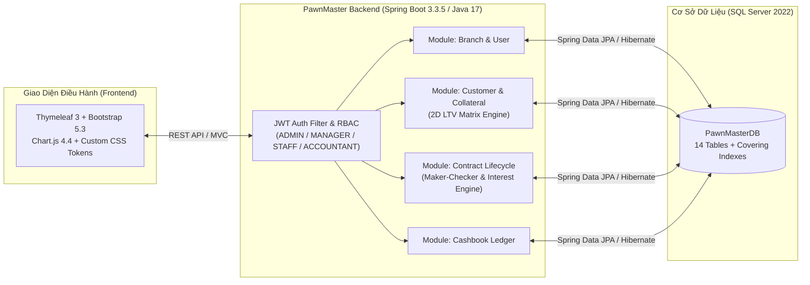

# 🏦 PawnMaster — Hệ Thống Quản Lý Cầm Đồ Đa Chi Nhánh (Enterprise Pawnshop Management System)


**PawnMaster** là hệ thống lõi quản lý hoạt động kinh doanh cầm đồ và cho vay thế chấp tài sản đa chi nhánh (Multi-Branch Collateral Lending & Pawnshop ERP). Hệ thống được thiết kế chuyên biệt cho tốc độ giao dịch tại quầy (Counter Speed), kiểm soát rủi ro thẩm định 2 chiều (**2D LTV Matrix**), phê duyệt 2 bước (**Maker-Checker**) và tính toàn vẹn tuyệt đối giữa **Kho vật lý (Vault) ↔ Hợp đồng (Contract) ↔ Sổ quỹ (Cashbook)**.

---

## 📑 Mục Lục (Table of Contents)

1. [Điểm Nổi Bật & Nghiệp Vụ Cốt Lõi](#-1-điểm-nổi-bật--nghiệp-vụ-cốt-lõi)
2. [Kiến Trúc Hệ Thống & Công Nghệ](#-2-kiến-trúc-hệ-thống--công-nghệ)
3. [Cấu Trúc Thư Mục Dự Án](#-3-cấu-trúc-thư-mục-dự-án)
4. [Hướng Dẫn Cài Đặt & Khởi Chạy Nhanh](#-4-hướng-dẫn-cài-đặt--khởi-chạy-nhanh)
5. [Tài Khoản Demo & Phân Quyền RBAC](#-5-tài-khoản-demo--phân-quyền-rbac)
6. [Danh Mục API Chính (RESTful Endpoints)](#-6-danh-mục-api-chính-restful-endpoints)
7. [Kiểm Thử (Unit Tests & E2E Verification)](#-7-kiểm-thử-unit-tests--e2e-verification)
8. [Tài Liệu Kỹ Thuật & Quy Trình Cập Nhật README](#-8-tài-liệu-kỹ-thuật--quy-trình-cập-nhật-readme)
9. [Quy Chuẩn Git Workflow](#-9-quy-chuẩn-git-workflow)

---

## 🌟 1. Điểm Nổi Bật & Nghiệp Vụ Cốt Lõi

Hệ thống được chia thành **5 phân hệ độc lập** (Modular Monolith):

| Phân hệ (Module) | Chức năng nghiệp vụ chính |
| :--- | :--- |
| **1. Đa Chi Nhánh & Phân Quyền (`branch` & `user`)** | • Quản lý chuỗi chi nhánh gắn với danh mục Đơn vị hành chính Việt Nam chuẩn GSO (63 Tỉnh/TP, 700 Quận/Huyện, 10.597 Phường/Xã).<br>• Xác thực **Stateless JWT** kết hợp **Spring Security RBAC** theo 4 vai trò: `ADMIN`, `MANAGER`, `STAFF`, `ACCOUNTANT`. |
| **2. Khách Hàng, Tài Sản & Ma Trận LTV 2 Chiều (`customer` & `collateral`)** | • Phân loại khách hàng theo **6 nhóm nghề nghiệp (`CustomerOccupationGroup`)** kèm kiểm tra **Chứng từ xác minh bắt buộc (`VerificationDocumentType`)**.<br>• Quản lý **8 danh mục tài sản cầm cố (`CollateralCategory`)**.<br>• Tự động tra cứu trần giải ngân tối đa qua **Ma trận LTV 2 chiều (6 Nhóm KH × 8 Loại tài sản)**. |
| **3. Vòng Đời Hợp Đồng 2 Bước (`contract`)** | • **Quy trình Maker-Checker**: Nhân viên (`STAFF`) lập hồ sơ ở trạng thái `PENDING_APPROVAL` → Quản lý chi nhánh (`MANAGER`) rà soát chứng từ và **Phê duyệt Giải ngân (`ACTIVE`)** hoặc **Từ chối (`CANCELLED`)**.<br>• Hỗ trợ 3 phương thức tính lãi chuẩn cầm đồ Việt Nam (`DAILY_PER_MILLION`, `PERCENT_MONTHLY`, `PERCENT_WEEKLY`), thu lãi định kỳ, trả bớt gốc, gia hạn, chuộc đồ (`REDEEMED`) và thanh lý (`LIQUIDATED`). |
| **4. Sổ Quỹ & Dòng Tiền Chi Nhánh (`cashbook`)** | • Tự động sinh phiếu Chi giải ngân (`CASH_OUT`) ngay khi hợp đồng được duyệt và phiếu Thu (`CASH_IN`) khi thu lãi/gốc/thanh lý.<br>• Kiểm soát hạn mức vốn (`capitalLimit`) và số dư quỹ tiền mặt thực tế (`currentCashBalance`) theo từng chi nhánh. |
| **5. Giao Diện Điều Hành Dual-Mode (`dashboard`)** | • Giao diện chuẩn Fintech (Slate Blue & Tabular Numerals `tabular-nums`, đạt chuẩn tương phản **WCAG 2.1 AA/AAA**).<br>• Hỗ trợ **Dual-mode**: Chạy động qua **Spring Boot + Thymeleaf 3** hoặc mở trực tiếp file HTML tĩnh (Standalone Preview). |

---

## 🛠 2. Kiến Trúc Hệ Thống & Công Nghệ



### Tech Stack Chi Tiết
- **Backend**: Java 17, Spring Boot 3.3.5 (Spring Web, Spring Data JPA, Spring Security, Bean Validation), Lombok, MapStruct 1.5.5, JJWT 0.12.6.
- **Database**: Microsoft SQL Server 2022 (Docker Compose), HikariCP Connection Pool.
- **Frontend**: HTML5, Thymeleaf 3, Bootstrap 5.3.3, Bootstrap Icons 1.11.3, Chart.js 4.4.7, Vanilla ES6+ JavaScript.
- **Testing**: JUnit 5, Mockito, Spring Security Test, Node.js Custom E2E DOM/WCAG Verification Suite (148 checks).

---

## 📂 3. Cấu Trúc Thư Mục Dự Án

<!-- AUTO-UPDATE: PROJECT_STRUCTURE -->
```text
PawnMaster/
├── docs/                                   # Tài liệu kỹ thuật & Đặc tả chuyên sâu
│   ├── CODE_GENERATION_RULES.md            # Quy tắc sinh mã định danh (Luhn Mod-36, Time-ordered Base36)
│   └── DATABASE_SPECIFICATION.md           # Đặc tả chi tiết 13 bảng CSDL, ERD & Index SQL Server
├── src/
│   ├── main/
│   │   ├── java/com/pawnmaster/api/
│   │   │   ├── common/                     # BaseEntity, BaseResponse, BusinessCodeGenerator, Exception
│   │   │   ├── config/                     # SecurityConfig, JpaAuditingConfig, WebMvcConfig
│   │   │   ├── security/                   # JwtTokenProvider, JwtAuthenticationFilter, UserPrincipal
│   │   │   └── modules/                    # 6 Domain Modules theo kiến trúc Package-by-Feature
│   │   │       ├── branch/                 # Quản lý Chi nhánh & Đơn vị hành chính (Tỉnh/Huyện/Xã)
│   │   │       ├── user/                   # Quản lý Nhân sự & Xác thực (/auth/login)
│   │   │       ├── customer/               # Quản lý Khách hàng, 6 Nhóm nghề nghiệp & Chứng từ (VerificationDocumentPolicy)
│   │   │       ├── collateral/             # Quản lý Tài sản cầm cố & LtvPolicyService (Ma trận LTV DB-backed)
│   │   │       ├── contract/               # Quản lý Hợp đồng, Phê duyệt 2 bước, Đóng lãi & Chuộc đồ
│   │   │       ├── cashbook/               # Quản lý Sổ quỹ Thu/Chi & Tổng hợp dòng tiền
│   │   │       └── dashboard/              # Web Controller phục vụ giao diện Dashboard & Login
│   │   └── resources/
│   │       ├── db/                         # SQL Scripts: schema.sql (DDL 14 bảng & Index) & data.sql (DML Seed)
│   │       ├── static/                     # Assets: css/ (dashboard.css, login.css), js/ (dashboard.js, login.js)
│   │       ├── templates/                  # Thymeleaf Views: dashboard.html, login.html
│   │       └── application.yml             # Cấu hình Spring Boot, SQL Server & JWT
│   └── test/java/com/pawnmaster/api/       # Bộ Unit Test & Integration Test (JUnit 5)
├── tests/                                  # Bộ kiểm thử giao diện & E2E tự động (Node.js)
├── DESIGN.md                               # Hệ thống Design Tokens & Quy chuẩn UI/UX Fintech
├── PRODUCT.md                              # Tầm nhìn sản phẩm & Nguyên tắc nghiệp vụ
├── PROJECT.md                              # Tổng quan kiến trúc Dashboard & Feature Inventory
├── SPEC.md                                 # Đặc tả nghiệp vụ toàn diện (Capability Map & LTV Matrix)
├── docker-compose.yml                      # Cấu hình khởi chạy nhanh SQL Server 2022
└── pom.xml                                 # Cấu hình Maven build & dependencies
```
<!-- /AUTO-UPDATE: PROJECT_STRUCTURE -->

---

## 🚀 4. Hướng Dẫn Cài Đặt & Khởi Chạy Nhanh

### Yêu cầu môi trường (Prerequisites)
- **JDK 17** trở lên
- **Maven 3.8+**
- **Docker & Docker Compose** (hoặc Microsoft SQL Server 2019/2022 cài đặt sẵn)
- **Node.js 18+** *(tùy chọn, dùng để chạy bộ kiểm thử giao diện E2E trong thư mục `tests/`)*

### Bước 1: Khởi chạy SQL Server qua Docker Compose
```bash
docker compose up -d
```
> Container `pawnmaster-sqlserver` sẽ chạy ở cổng `1433` với mật khẩu mặc định của tài khoản `sa` là `Snowfox123@`.

### Bước 2: Khởi tạo Database & Nạp dữ liệu mẫu (Seed Data)
Toàn bộ cấu trúc CSDL (14 bảng) và dữ liệu mẫu đã được tối giản thành **2 file SQL duy nhất** trong `src/main/resources/db/`:
1. `src/main/resources/db/schema.sql` *(Tạo database `PawnMasterDB`, 14 bảng, Covering Indexes và hàm Checksum `fn_CalcLuhnMod36`)*
2. `src/main/resources/db/data.sql` *(Import danh mục hành chính VN, 48 cấu hình Ma trận LTV `ltv_policies`, 6 quy tắc mã code và dữ liệu mẫu 5 chi nhánh)*

### Bước 3: Cấu hình biến môi trường (Tùy chọn)
Hệ thống đã có cấu hình mặc định trong `src/main/resources/application.yml`. Bạn có thể ghi đè qua biến môi trường khi triển khai thực tế:

| Biến môi trường | Mặc định (Local Dev) | Mô tả |
| :--- | :--- | :--- |
| `DB_HOST` | `localhost` | Địa chỉ máy chủ SQL Server |
| `DB_PORT` | `1433` | Cổng kết nối SQL Server |
| `DB_NAME` | `PawnMasterDB` | Tên cơ sở dữ liệu |
| `DB_USERNAME` | `sa` | Tài khoản đăng nhập CSDL |
| `DB_PASSWORD` | `Snowfox123@` | Mật khẩu CSDL |

### Bước 4: Biên dịch và chạy ứng dụng Spring Boot
```bash
mvn clean spring-boot:run
```
Sau khi khởi động thành công, truy cập:
- **Trang Đăng nhập**: `http://localhost:8080/login`
- **Bảng Điều hành (Dashboard)**: `http://localhost:8080/dashboard`

---

## 🔐 5. Tài Khoản Demo & Phân Quyền RBAC

Dữ liệu mẫu (`src/main/resources/db/data.sql`) cung cấp sẵn các tài khoản theo 4 cấp phân quyền:

| Vai trò (`RoleEnum`) | Username | Mật khẩu mặc định | Quyền hạn trong hệ thống |
| :--- | :--- | :--- | :--- |
| **`ADMIN`** *(Chủ chuỗi)* | `admin` | `Admin@123` | Quản trị toàn chuỗi 5 chi nhánh, cấu hình hạn mức vốn, phê duyệt mọi hợp đồng. |
| **`MANAGER`** *(Quản lý CN)* | `manager_hcm1` | `Password@123` | Quản lý Chi nhánh Quận 1 (`CN-HCM-01`), duyệt/từ chối giải ngân hồ sơ `PENDING_APPROVAL`. |
| **`STAFF`** *(Giao dịch viên)* | `staff_hcm1_01` | `Password@123` | Lập hồ sơ cầm cố mới, tải ảnh chứng từ xác minh, thu lãi định kỳ, chuộc đồ tại quầy. |
| **`ACCOUNTANT`** *(Kế toán)* | `accountant_hcm1` | `Password@123` | Đối soát sổ quỹ Thu/Chi (`CASH_IN`/`CASH_OUT`), kiểm toán tồn quỹ và kho tài sản. |

---

## 🔌 6. Danh Mục API Chính (RESTful Endpoints)

<!-- AUTO-UPDATE: API_ENDPOINTS -->
| Phân hệ | Method & Endpoint | Mô tả chức năng | Quyền truy cập |
| :--- | :--- | :--- | :--- |
| **Auth** | `POST /api/v1/auth/login` | Đăng nhập và nhận JWT Access Token kèm thông tin chi nhánh | Public |
| **Branches** | `GET /api/v1/branches` | Danh sách chi nhánh (hỗ trợ lọc theo `provinceCode`, `districtCode`) | Authenticated |
| **Branches** | `POST /api/v1/branches` | Tạo chi nhánh cầm đồ mới và cấp hạn mức vốn | `ADMIN` |
| **Customers** | `GET /api/v1/customers` | Tra cứu khách hàng toàn chuỗi (theo mã KH, CCCD, SĐT) | Authenticated |
| **Customers** | `POST /api/v1/customers` | Đăng ký khách hàng kèm nhóm nghề nghiệp (1–6) & chứng từ | `STAFF`, `MANAGER`, `ADMIN` |
| **Collaterals** | `POST /api/v1/collaterals/evaluate-ltv` | Thẩm định nhanh trần LTV tối đa theo `(Nhóm KH × Loại tài sản)` | Authenticated |
| **Contracts** | `POST /api/v1/contracts` | **Bước 1 (Maker)**: Lập hồ sơ hợp đồng mới ở trạng thái `PENDING_APPROVAL` | `STAFF`, `MANAGER`, `ADMIN` |
| **Contracts** | `POST /api/v1/contracts/{id}/approve` | **Bước 2 (Checker)**: Quản lý chi nhánh duyệt hồ sơ → Chuyển `ACTIVE` & Chi quỹ | `MANAGER`, `ADMIN` |
| **Contracts** | `POST /api/v1/contracts/{id}/reject` | Quản lý chi nhánh từ chối hồ sơ → Chuyển `CANCELLED` | `MANAGER`, `ADMIN` |
| **Contracts** | `POST /api/v1/contracts/{id}/collect-interest` | Thu lãi định kỳ / Trả bớt gốc & tự động ghi phiếu thu sổ quỹ | `STAFF`, `MANAGER`, `ADMIN` |
| **Contracts** | `POST /api/v1/contracts/{id}/redeem` | Tất toán hợp đồng, chuộc tài sản (`REDEEMED`) & xuất kho | `STAFF`, `MANAGER`, `ADMIN` |
| **Cashbook** | `GET /api/v1/cashbook` | Tra cứu lịch sử giao dịch sổ quỹ Thu/Chi & tổng hợp dòng tiền | Authenticated |
<!-- /AUTO-UPDATE: API_ENDPOINTS -->

---

## 🧪 7. Kiểm Thử (Unit Tests & E2E Verification)

Dự án áp dụng quy trình kiểm thử nghiêm ngặt ở cả tầng Backend (Java) và Frontend (DOM/WCAG):

### 1. Chạy toàn bộ Unit & Integration Tests (Backend)
```bash
mvn test
```
> Kiểm tra toàn diện logic sinh mã định danh (`BusinessCodeGeneratorTest`), ma trận LTV 2 chiều (`LtvPolicyServiceTest`), quy trình phê duyệt hợp đồng 2 bước (`ContractApprovalWorkflowTest`), sổ quỹ (`CashbookServiceTest`) và phân quyền bảo mật (`LoginAndAuthGateTest`).

### 2. Chạy bộ kiểm thử E2E Giao diện & WCAG (Frontend)
```bash
node tests/run_tests.js
```
> Thực thi **148 bài kiểm tra tự động** xuyên suốt 4 tầng (Feature Coverage, Boundary & XML Safety, Cross-Feature Bindings, và WCAG 2.1 AA Contrast Verification).

---

## 📚 8. Tài Liệu Kỹ Thuật & Quy Trình Cập Nhật README

### Bản đồ tài liệu trong dự án
Để giữ cho `README.md` luôn gọn gàng và dễ bảo trì, các đặc tả chi tiết được tách thành các tài liệu chuyên biệt:
- 📐 **[`SPEC.md`](./SPEC.md)**: Đặc tả nghiệp vụ tổng thể, Ma trận LTV 2 chiều, Quy trình Maker-Checker.
- 🗄️ **[`docs/DATABASE_SPECIFICATION.md`](./docs/DATABASE_SPECIFICATION.md)**: Đặc tả 13 bảng CSDL SQL Server, sơ đồ ERD và thiết kế Index.
- 🔢 **[`docs/CODE_GENERATION_RULES.md`](./docs/CODE_GENERATION_RULES.md)**: Quy chuẩn sinh mã định danh nghiệp vụ (`KH-`, `HD-`, `TS-`, `PT-`, `IN/OUT-`) tối ưu B-Tree Index.
- 🎨 **[`DESIGN.md`](./DESIGN.md)** & **[`PROJECT.md`](./PROJECT.md)**: Hệ thống Design Tokens, bảng màu Fintech và cấu trúc giao diện Dashboard.

### 🔄 Hướng dẫn bảo trì khi dự án thay đổi (Living Documentation)
Khi bạn hoặc AI Agent thêm tính năng mới vào dự án, chỉ cần cập nhật `README.md` tại các vùng đánh dấu:
1. **Thêm Module / Thư mục mới**: Cập nhật khối `<!-- AUTO-UPDATE: PROJECT_STRUCTURE -->` ở **Mục 3**.
2. **Thêm API Endpoint mới**: Cập nhật bảng trong khối `<!-- AUTO-UPDATE: API_ENDPOINTS -->` ở **Mục 6**.
3. **Thay đổi CSDL hoặc Quy tắc nghiệp vụ**: Cập nhật chi tiết trong `docs/DATABASE_SPECIFICATION.md` hoặc `SPEC.md`, giữ nguyên liên kết tại **Mục 8**.

---

## 🌿 9. Quy Chuẩn Git Workflow

Dự án áp dụng **GitHub Flow** kết hợp chuẩn **Conventional Commits**:

### 1. Chiến lược nhánh (Branching Strategy)
- `main`: Nhánh chính luôn ở trạng thái ổn định, sẵn sàng triển khai (Protected).
- Nhánh tính năng: `feature/<tên-tính-năng>` (ví dụ: `feature/collateral-auction`, `feature/sms-reminder`).
- Nhánh sửa lỗi: `fix/<tên-lỗi>` (ví dụ: `fix/interest-rounding`).

### 2. Quy ước Commit Message (Conventional Commits)
Dự án đã cấu hình sẵn file mẫu `.gitmessage`. Bạn có thể kích hoạt template mặc định bằng lệnh:
```bash
git config commit.template .gitmessage
```
Định dạng chuẩn:
```text
<type>(<scope>): <mô tả ngắn gọn>

Ví dụ:
feat(contract): add two-step manager approval workflow
fix(cashbook): prevent disbursement when exceeding branch capital limit
docs(readme): update API endpoints table for liquidation module
```
