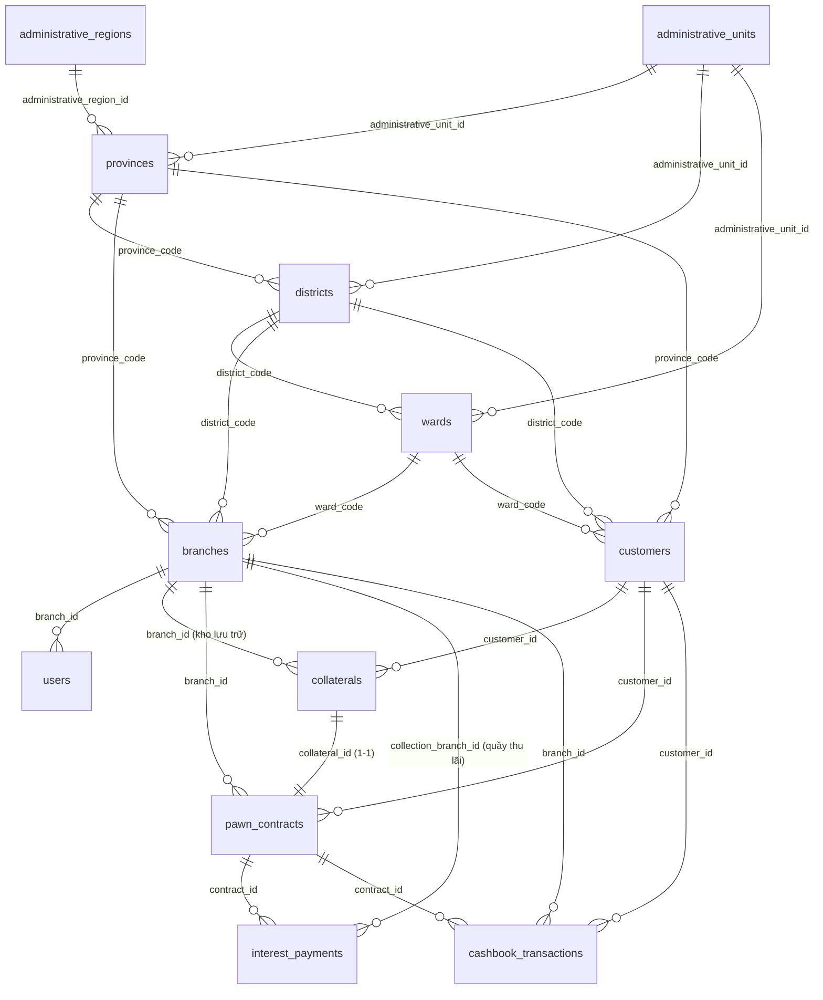

# Đặc Tả Cơ Sở Dữ Liệu (Database Specification) — Hệ Thống PawnMaster

> **Hệ quản trị CSDL (DBMS)**: Microsoft SQL Server 2022 (`PawnMasterDB`)  
> **Schema**: `dbo`  
> **Chuẩn mã hóa Tiếng Việt**: `NVARCHAR` (UTF-16LE cho các trường văn bản tiếng Việt) & `VARCHAR` (ASCII 1-byte cho mã code, enum, số điện thoại, CCCD để tối ưu B-Tree Index)  
> **Tài liệu liên quan**:
> - Quy tắc sinh mã định danh nghiệp vụ: [`docs/CODE_GENERATION_RULES.md`](./CODE_GENERATION_RULES.md)
> - DDL Tạo toàn bộ Bảng, Index & Hàm hệ thống: [`src/main/resources/db/schema.sql`](../src/main/resources/db/schema.sql)
> - DML Import toàn bộ Dữ liệu Hành chính, Cấu hình & Nghiệp vụ: [`src/main/resources/db/data.sql`](../src/main/resources/db/data.sql)

---

## 1. Tổng Quan Kiến Trúc Cơ Sở Dữ Liệu (14 Bảng)

Cơ sở dữ liệu `PawnMasterDB` gồm **14 bảng** được chia thành **3 phân hệ chức năng**:

| Phân hệ | STT | Tên bảng (`dbo.*`) | Ý nghĩa / Chức năng chính | Số bản ghi chuẩn / Seed |
| :--- | :-: | :--- | :--- | :--- |
| **I. Danh mục Đơn vị Hành chính Việt Nam** *(Chuẩn Tổng cục Thống kê - GSO)* | 1 | `administrative_regions` | Lưu 8 vùng địa lý kinh tế - hành chính của Việt Nam (Đông Nam Bộ, ĐB Sông Hồng,...) | 8 vùng |
| | 2 | `administrative_units` | Lưu 10 cấp/loại đơn vị hành chính (Thành phố trực thuộc TW, Tỉnh, Quận, Huyện, Phường, Xã,...) | 10 loại đơn vị |
| | 3 | `provinces` | Lưu danh mục 63 Tỉnh / Thành phố trực thuộc Trung ương | 63 tỉnh/thành |
| | 4 | `districts` | Lưu danh mục Quận / Huyện / Thị xã / Thành phố thuộc tỉnh | 700 quận/huyện |
| | 5 | `wards` | Lưu danh mục Phường / Xã / Thị trấn trên toàn quốc | 10.597 phường/xã |
| **II. Phân hệ Nghiệp vụ Cốt lõi (Core Pawnshop Domain)** | 6 | `branches` | Lưu thông tin các Chi nhánh / Cửa hàng cầm đồ, hạn mức vốn và số dư quỹ tiền mặt | 5 chi nhánh |
| | 7 | `users` | Lưu tài khoản nhân sự (Admin, Quản lý chi nhánh, Giao dịch viên, Kế toán) và phân quyền RBAC | 14 nhân sự |
| | 8 | `customers` | Lưu hồ sơ Khách hàng toàn chuỗi, CCCD, nhóm nghề nghiệp (1–6) và chứng từ xác minh | 22 khách hàng |
| | 9 | `collaterals` | Lưu thông tin Tài sản cầm cố, định giá, trần LTV, số khung/số máy/IMEI và vị trí lưu kho | 22 tài sản |
| | 10 | `pawn_contracts` | Lưu Hợp đồng cầm đồ, lãi suất, phí lưu kho, kỳ hạn, trạng thái phê duyệt 2 bước và dư nợ gốc | 22 hợp đồng |
| | 11 | `interest_payments` | Lưu lịch sử các kỳ Đóng lãi, Trả bớt gốc, Tất toán chuộc đồ và Thanh lý của từng hợp đồng | 14 phiếu đóng lãi/gốc |
| | 12 | `cashbook_transactions` | Lưu Sổ quỹ Thu / Chi (`CASH_IN` / `CASH_OUT`) và biến động dòng tiền thực tế tại từng chi nhánh | 39 giao dịch sổ quỹ |
| | 13 | `ltv_policies` | Lưu cấu hình Ma trận tỷ lệ cho vay tối đa (Max LTV) theo Nhóm nghề nghiệp và Loại tài sản | 48 quy tắc LTV |
| **III. Quản trị Quy chuẩn Hệ thống** | 14 | `business_code_rules` | Lưu đặc tả quy tắc sinh mã code, biểu thức Regex, thuật toán Checksum và chiến lược Index của từng bảng | 6 bộ quy tắc |

---

## 2. Sơ Đồ Quan Hệ Thực Thể (Entity-Relationship Diagram)

---

## 3. Các Cột Audit & Xóa Mềm Dùng Chung (`BaseEntity`)

Tất cả **7 bảng nghiệp vụ cốt lõi** (`branches`, `users`, `customers`, `collaterals`, `pawn_contracts`, `interest_payments`, `cashbook_transactions`) đều kế thừa từ lớp [`BaseEntity.java`](../src/main/java/com/pawnmaster/api/common/BaseEntity.java) và có chung bộ 6 cột hệ thống sau:

| Tên cột | Kiểu dữ liệu | Nullable | Mặc định (`DEFAULT`) | Giải thích chi tiết |
| :--- | :--- | :-: | :--- | :--- |
| `id` | `BIGINT IDENTITY(1,1)` | `NOT NULL` | Tự tăng `1, 2, 3...` | **Khóa chính vật lý (Clustered Primary Key)**. Dùng cho toàn bộ liên kết khóa ngoại (`FOREIGN KEY`) để tối ưu tốc độ `JOIN` (8 bytes). |
| `created_at` | `DATETIME2` | `NOT NULL` | `SYSDATETIME()` | Thời điểm bản ghi được khởi tạo lần đầu tiên trong hệ thống. Không được phép cập nhật (`updatable = false`). |
| `updated_at` | `DATETIME2` | `NULL` | `NULL` | Thời điểm bản ghi được chỉnh sửa gần nhất. Tự động cập nhật qua `@PreUpdate` hoặc câu lệnh `UPDATE`. |
| `created_by` | `VARCHAR(100)` | `NULL` | `'SYSTEM'` | Username hoặc định danh người/tiến trình tạo bản ghi (ví dụ: `'admin'`, `'staff_hcm1_01'`, `'SYSTEM'`). |
| `updated_by` | `VARCHAR(100)` | `NULL` | `NULL` | Username của người thực hiện thao tác chỉnh sửa gần nhất. |
| `is_deleted` | `BIT` | `NOT NULL` | `0` (`false`) | **Cờ xóa mềm (Soft Delete)**:<ul><li>`0`: Bản ghi đang hoạt động bình thường.</li><li>`1`: Bản ghi đã bị xóa logic (ẩn khỏi danh sách tra cứu thông thường nhưng vẫn giữ lại để phục vụ kiểm toán tài chính).</li></ul> |

---

## 4. Đặc Tả Chi Tiết Từng Bảng Trong Cơ Sở Dữ Liệu

---

### PHÂN HỆ I: DANH MỤC ĐƠN VỊ HÀNH CHÍNH VIỆT NAM

#### Bảng 1: `dbo.administrative_regions` (Vùng địa lý hành chính)
* **Mục đích**: Lưu 8 vùng kinh tế - địa lý của Việt Nam để thống kê, phân tích dư nợ và hiệu quả kinh doanh theo vùng miền.
* **Entity ánh xạ**: [`AdministrativeRegionEntity.java`](../src/main/java/com/pawnmaster/api/modules/branch/AdministrativeRegionEntity.java)

| Tên cột | Kiểu dữ liệu | Ràng buộc | Giá trị lưu & Giải thích |
| :--- | :--- | :--- | :--- |
| `id` | `INT` | `PK, NOT NULL` | Mã số vùng từ `1` đến `8`: `1`: Đông Bắc Bộ \| `2`: Tây Bắc Bộ \| `3`: Đồng bằng sông Hồng \| `4`: Bắc Trung Bộ \| `5`: Duyên hải Nam Trung Bộ \| `6`: Tây Nguyên \| `7`: Đông Nam Bộ \| `8`: Đồng bằng sông Cửu Long. |
| `name` | `NVARCHAR(255)` | `NOT NULL` | Tên vùng bằng tiếng Việt có dấu (VD: `N'Đông Nam Bộ'`, `N'Đồng bằng sông Hồng'`). |
| `name_en` | `NVARCHAR(255)` | `NOT NULL` | Tên vùng bằng tiếng Anh (VD: `N'Southeast'`, `N'Red River Delta'`). |
| `code_name` | `VARCHAR(255)` | `NULL` | Mã slug tiếng Việt không dấu nối bằng gạch dưới (VD: `'dong_nam_bo'`). |
| `code_name_en` | `VARCHAR(255)` | `NULL` | Mã slug tiếng Anh (VD: `'southeast'`). |

---

#### Bảng 2: `dbo.administrative_units` (Loại/Cấp đơn vị hành chính)
* **Mục đích**: Phân loại cấp hành chính của Tỉnh/Thành, Quận/Huyện, Phường/Xã.
* **Entity ánh xạ**: [`AdministrativeUnitEntity.java`](../src/main/java/com/pawnmaster/api/modules/branch/AdministrativeUnitEntity.java)

| Tên cột | Kiểu dữ liệu | Ràng buộc | Giá trị lưu & Giải thích |
| :--- | :--- | :--- | :--- |
| `id` | `INT` | `PK, NOT NULL` | Mã loại đơn vị hành chính từ `1` đến `10`:<ul><li>**Cấp Tỉnh (1–2)**: `1` = Thành phố trực thuộc trung ương, `2` = Tỉnh.</li><li>**Cấp Huyện (3–7)**: `3` = Thành phố thuộc thành phố trực thuộc TW (VD: TP. Thủ Đức), `4` = Thành phố thuộc tỉnh, `5` = Quận, `6` = Thị xã, `7` = Huyện.</li><li>**Cấp Xã (8–10)**: `8` = Phường, `9` = Thị trấn, `10` = Xã.</li></ul> |
| `full_name` | `NVARCHAR(255)` | `NULL` | Tên đầy đủ cấp hành chính tiếng Việt (VD: `N'Thành phố trực thuộc trung ương'`, `N'Quận'`). |
| `full_name_en` | `NVARCHAR(255)` | `NULL` | Tên đầy đủ tiếng Anh (VD: `N'Municipality'`, `N'Urban District'`). |
| `short_name` | `NVARCHAR(255)` | `NULL` | Tên rút gọn tiếng Việt (VD: `N'Thành phố'`, `N'Tỉnh'`, `N'Quận'`, `N'Phường'`). |
| `short_name_en` | `NVARCHAR(255)` | `NULL` | Tên rút gọn tiếng Anh (VD: `N'City'`, `N'Province'`, `N'Ward'`). |
| `code_name` | `VARCHAR(255)` | `NULL` | Định danh dạng snake_case tiếng Việt (VD: `'thanh_pho_truc_thuoc_trung_uong'`). |
| `code_name_en` | `VARCHAR(255)` | `NULL` | Định danh dạng snake_case tiếng Anh (VD: `'municipality'`). |

---

#### Bảng 3: `dbo.provinces` (Danh mục 63 Tỉnh / Thành phố)
* **Mục đích**: Lưu 63 Tỉnh/Thành phố Việt Nam theo mã chuẩn Tổng cục Thống kê (GSO).
* **Entity ánh xạ**: [`ProvinceEntity.java`](../src/main/java/com/pawnmaster/api/modules/branch/ProvinceEntity.java)

| Tên cột | Kiểu dữ liệu | Ràng buộc | Giá trị lưu & Giải thích |
| :--- | :--- | :--- | :--- |
| `code` | `VARCHAR(20)` | `PK, NOT NULL` | Mã Tỉnh/TP chuẩn GSO gồm 2 chữ số (VD: `'01'` = Hà Nội, `'48'` = Đà Nẵng, `'79'` = TP. Hồ Chí Minh, `'92'` = Cần Thơ). **Lưu ý**: Lưu dạng chuỗi có số `0` ở đầu (`'01'`), không dùng kiểu `INT`. |
| `name` | `NVARCHAR(255)` | `NOT NULL` | Tên ngắn gọn không kèm tiền tố cấp hành chính (VD: `N'Hà Nội'`, `N'Hồ Chí Minh'`). |
| `name_en` | `NVARCHAR(255)` | `NULL` | Tên ngắn gọn tiếng Anh (VD: `N'Ha Noi'`, `N'Ho Chi Minh'`). |
| `full_name` | `NVARCHAR(255)` | `NOT NULL` | Tên hành chính đầy đủ dùng để hiển thị lên UI/Hợp đồng (VD: `N'Thành phố Hà Nội'`, `N'Thành phố Hồ Chí Minh'`). |
| `full_name_en` | `NVARCHAR(255)` | `NULL` | Tên đầy đủ tiếng Anh (VD: `N'Ha Noi City'`, `N'Ho Chi Minh City'`). |
| `code_name` | `VARCHAR(255)` | `NULL` | Mã code không dấu (VD: `'ha_noi'`, `'ho_chi_minh'`). |
| `administrative_unit_id` | `INT` | `FK -> administrative_units(id)` | Phân biệt Thành phố trực thuộc TW (`1`) hay Tỉnh (`2`). |
| `administrative_region_id` | `INT` | `FK -> administrative_regions(id)` | Vùng địa lý mà Tỉnh/TP trực thuộc (`1`..`8`). |

---

#### Bảng 4: `dbo.districts` (Danh mục 700 Quận / Huyện / Thị xã / TP thuộc Tỉnh)
* **Mục đích**: Lưu cấp hành chính bậc 2 trực thuộc Tỉnh/Thành phố.
* **Entity ánh xạ**: [`DistrictEntity.java`](../src/main/java/com/pawnmaster/api/modules/branch/DistrictEntity.java)

| Tên cột | Kiểu dữ liệu | Ràng buộc | Giá trị lưu & Giải thích |
| :--- | :--- | :--- | :--- |
| `code` | `VARCHAR(20)` | `PK, NOT NULL` | Mã Quận/Huyện chuẩn GSO gồm 3 chữ số (VD: `'001'` = Quận Ba Đình, `'760'` = Quận 1, `'769'` = TP. Thủ Đức, `'492'` = Quận Hải Châu, `'916'` = Quận Ninh Kiều). |
| `name` | `NVARCHAR(255)` | `NOT NULL` | Tên ngắn gọn (VD: `N'1'`, `N'Thủ Đức'`, `N'Ba Đình'`). |
| `name_en` | `NVARCHAR(255)` | `NULL` | Tên tiếng Anh (VD: `N'1'`, `N'Thu Duc'`, `N'Ba Dinh'`). |
| `full_name` | `NVARCHAR(255)` | `NULL` | Tên hành chính đầy đủ (VD: `N'Quận 1'`, `N'Thành phố Thủ Đức'`, `N'Quận Ba Đình'`). **Lưu ý**: Khi hiển thị tên Quận (như Quận 1, Quận 3), luôn lấy cột `full_name` thay vì `name` để tránh chỉ hiện số `'1'`. |
| `full_name_en` | `NVARCHAR(255)` | `NULL` | Tên đầy đủ tiếng Anh (VD: `N'District 1'`, `N'Thu Duc City'`). |
| `code_name` | `VARCHAR(255)` | `NULL` | Mã slug (VD: `'quan_1'`, `'thu_duc'`). |
| `province_code` | `VARCHAR(20)` | `FK -> provinces(code)` | Mã Tỉnh/Thành phố cha. Được đánh Index `idx_districts_province` để lọc nhanh Quận/Huyện khi chọn Tỉnh/TP. |
| `administrative_unit_id` | `INT` | `FK -> administrative_units(id)` | Loại đơn vị cấp huyện (`3` = TP thuộc TP TW, `4` = TP thuộc tỉnh, `5` = Quận, `6` = Thị xã, `7` = Huyện). |

---

#### Bảng 5: `dbo.wards` (Danh mục 10.597 Phường / Xã / Thị trấn)
* **Mục đích**: Lưu cấp hành chính bậc 3 trực thuộc Quận/Huyện, dùng để chuẩn hóa địa chỉ chi nhánh (`branches.ward_code`) và địa chỉ thường trú khách hàng (`customers.ward_code`) chính xác đến cấp Phường/Xã.
* **Entity ánh xạ**: [`WardEntity.java`](../src/main/java/com/pawnmaster/api/modules/branch/WardEntity.java)

| Tên cột | Kiểu dữ liệu | Ràng buộc | Giá trị lưu & Giải thích |
| :--- | :--- | :--- | :--- |
| `code` | `VARCHAR(20)` | `PK, NOT NULL` | Mã Phường/Xã chuẩn GSO gồm 5 chữ số (VD: `'00025'` = Phường Điện Biên, `'26734'` = Phường Bến Nghé, `'26740'` = Phường Bến Thành). |
| `name` | `NVARCHAR(255)` | `NOT NULL` | Tên ngắn gọn (VD: `N'Bến Nghé'`, `N'Linh Chiểu'`). |
| `name_en` | `NVARCHAR(255)` | `NULL` | Tên tiếng Anh (VD: `N'Ben Nghe'`). |
| `full_name` | `NVARCHAR(255)` | `NULL` | Tên hành chính đầy đủ (VD: `N'Phường Bến Nghé'`, `N'Phường Linh Chiểu'`). |
| `full_name_en` | `NVARCHAR(255)` | `NULL` | Tên đầy đủ tiếng Anh (VD: `N'Ben Nghe Ward'`). |
| `code_name` | `VARCHAR(255)` | `NULL` | Mã slug (VD: `'ben_nghe'`). |
| `district_code` | `VARCHAR(20)` | `FK -> districts(code)` | Mã Quận/Huyện cha (`idx_wards_district`). |
| `administrative_unit_id` | `INT` | `FK -> administrative_units(id)` | Loại đơn vị cấp xã (`8` = Phường, `9` = Thị trấn, `10` = Xã). |

---

### PHÂN HỆ II: CÁC BẢNG NGHIỆP VỤ CỐT LÕI (CORE PAWNSHOP TABLES)

---

#### Bảng 6: `dbo.branches` (Chi nhánh / Phòng Giao dịch Cầm đồ)
* **Mục đích**: Quản lý danh sách các chi nhánh trong chuỗi cầm đồ, địa bàn hành chính, hạn mức vốn cấp phát và **số dư quỹ tiền mặt tức thời** của từng chi nhánh.
* **Entity ánh xạ**: [`BranchEntity.java`](../src/main/java/com/pawnmaster/api/modules/branch/BranchEntity.java)

| Tên cột | Kiểu dữ liệu | Ràng buộc | Giá trị lưu & Giải thích |
| :--- | :--- | :--- | :--- |
| `id` | `BIGINT IDENTITY(1,1)` | `PK, NOT NULL` | ID chi nhánh (`1`, `2`, `3`...). Được dùng để sinh mã rút gọn `B01`, `B02` trong mã Hợp đồng và Tài sản. |
| `branch_code` | `VARCHAR(50)` | `UNIQUE, NOT NULL` | **Mã chi nhánh chuẩn**: `CN-<PROVINCE_ABBR>-<SEQ_2>` (VD: `'CN-HCM-01'`, `'CN-HCM-02'`, `'CN-HN-01'`, `'CN-DN-01'`, `'CN-CT-01'`). |
| `branch_name` | `NVARCHAR(150)` | `NOT NULL` | Tên hiển thị của chi nhánh (VD: `N'PawnMaster Quận 1 - Hội Sở'`). |
| `province_code` | `VARCHAR(20)` | `FK -> provinces(code), NOT NULL` | Mã Tỉnh/Thành phố nơi đặt chi nhánh (VD: `'79'`, `'01'`). |
| `district_code` | `VARCHAR(20)` | `FK -> districts(code), NOT NULL` | Mã Quận/Huyện nơi đặt chi nhánh (VD: `'760'`, `'769'`). |
| `ward_code` | `VARCHAR(20)` | `FK -> wards(code), NULL` | Mã Phường/Xã nơi đặt chi nhánh (VD: `'26740'`). |
| `address_detail` | `NVARCHAR(255)` | `NULL` | Địa chỉ chi tiết số nhà, tên đường, phường, quận, tỉnh/thành phố. |
| `phone_number` | `VARCHAR(20)` | `NULL` | Số điện thoại hotline của chi nhánh. |
| `capital_limit` | `DECIMAL(18, 2)` | `NOT NULL, DEFAULT 2500000000.00` | **Hạn mức vốn tối đa** Hội sở cấp cho chi nhánh (VNĐ). Mặc định: `2.500.000.000,00` VNĐ (2,5 tỷ). |
| `current_cash_balance` | `DECIMAL(18, 2)` | `NOT NULL, DEFAULT 500000000.00` | **Số dư tiền mặt thực tế tại két của chi nhánh** (VNĐ).<ul><li>Tự động **TĂNG** khi phát sinh Phiếu thu (`CASH_IN`: thu lãi, thu gốc, thanh lý, góp vốn).</li><li>Tự động **GIẢM** khi phát sinh Phiếu chi (`CASH_OUT`: giải ngân hợp đồng mới, chi phí vận hành).</li><li>**Không bao giờ được âm (`< 0`)**.</li></ul> |
| `is_active` | `BIT` | `NOT NULL, DEFAULT 1` | Trạng thái hoạt động của chi nhánh: `1` = Đang hoạt động, `0` = Tạm ngưng giao dịch. |
| *(Các cột Audit)* | — | — | `created_at`, `updated_at`, `created_by`, `updated_by`, `is_deleted`. |

> [!IMPORTANT]
> **Các lưu ý quan trọng của bảng `dbo.branches`**:
> 1. **Ràng buộc Chặn Giải Ngân (`Cash Balance Gate`)**: Khi Quản lý chi nhánh duyệt giải ngân hợp đồng (`approveAndDisburseContract`), nếu `principal_amount > current_cash_balance`, hệ thống sẽ ném lỗi `INSUFFICIENT_CASH_BALANCE` và chặn giải ngân ngay lập tức.
> 2. **Ràng buộc Địa giới Hành chính**: Cặp `(province_code, district_code, ward_code)` phải tuân thủ đúng quan hệ cha - con trong các bảng `provinces`, `districts`, `wards`.
> 3. **Index tối ưu**: `idx_branches_code_cov` (`UNIQUE NONCLUSTERED` kèm `INCLUDE (branch_name, province_code, district_code, current_cash_balance, is_active) WHERE is_deleted = 0`).

---

#### Bảng 7: `dbo.users` (Nhân viên & Phân quyền Quản trị)
* **Mục đích**: Quản lý tài khoản đăng nhập, mật khẩu mã hóa BCrypt, vai trò (`RoleEnum`) và chi nhánh công tác của nhân sự.
* **Entity ánh xạ**: [`UserEntity.java`](../src/main/java/com/pawnmaster/api/modules/user/UserEntity.java)

| Tên cột | Kiểu dữ liệu | Ràng buộc | Giá trị lưu & Giải thích |
| :--- | :--- | :--- | :--- |
| `id` | `BIGINT IDENTITY(1,1)` | `PK, NOT NULL` | ID định danh nhân viên. |
| `username` | `VARCHAR(50)` | `UNIQUE, NOT NULL` | Tên đăng nhập duy nhất (VD: `'admin'`, `'manager_hcm1'`, `'staff_hcm1_01'`, `'accountant_hq'`). |
| `password_hash` | `VARCHAR(255)` | `NOT NULL` | Chuỗi băm mật khẩu chuẩn **BCrypt** (`$2a$10$...`). Tuyệt đối không lưu plaintext. |
| `full_name` | `NVARCHAR(150)` | `NOT NULL` | Họ và tên đầy đủ của nhân viên. |
| `phone_number` | `VARCHAR(20)` | `NULL` | Số điện thoại liên hệ của nhân viên. |
| `email` | `VARCHAR(120)` | `NULL` | Địa chỉ email công vụ. |
| `role` | `VARCHAR(30)` | `NOT NULL, DEFAULT 'STAFF'` | **Vai trò phân quyền (`RoleEnum`)** — chỉ nhận 1 trong 4 giá trị:<ul><li>`'ADMIN'`: Quản trị viên toàn chuỗi (Hội sở) — toàn quyền xem & thao tác mọi chi nhánh.</li><li>`'MANAGER'`: Cửa hàng trưởng / Quản lý chi nhánh — có quyền **phê duyệt (`APPROVE`) hoặc từ chối (`REJECT`) hợp đồng** và xuất quỹ giải ngân tại chi nhánh mình quản lý.</li><li>`'STAFF'`: Giao dịch viên / Nhân viên thẩm định — lập hồ sơ khách hàng, định giá tài sản, tạo hợp đồng ở trạng thái `PENDING_APPROVAL`, thu lãi định kỳ; **không có quyền duyệt giải ngân**.</li><li>`'ACCOUNTANT'`: Kế toán — kiểm soát sổ quỹ, đối soát dòng tiền thu/chi.</li></ul> |
| `branch_id` | `BIGINT` | `FK -> branches(id), NULL` | Chi nhánh mà nhân viên trực thuộc:<ul><li>`NULL`: Dành cho tài khoản cấp Hội sở (`ADMIN`, `ACCOUNTANT` toàn chuỗi) có phạm vi `ALL_BRANCHES`.</li><li>`NOT NULL`: Nhân viên/Quản lý gắn cố định với 1 chi nhánh cụ thể (`SINGLE_BRANCH`).</li></ul> |
| `is_active` | `BIT` | `NOT NULL, DEFAULT 1` | `1` = Tài khoản được phép đăng nhập, `0` = Tài khoản bị khóa (`ACCOUNT_LOCKED`). |
| `last_login_at` | `DATETIME2` | `NULL` | Thời điểm đăng nhập thành công gần nhất. |
| *(Các cột Audit)* | — | — | `created_at`, `updated_at`, `created_by`, `updated_by`, `is_deleted`. |

> [!NOTE]
> **Lưu ý của bảng `dbo.users`**:
> - Một `MANAGER` của Chi nhánh 1 (`branch_id = 1`) **không được phép** phê duyệt hoặc giải ngân hợp đồng của Chi nhánh 2 (`branch_id = 2`) — [`ContractServiceImpl`](../src/main/java/com/pawnmaster/api/modules/contract/ContractServiceImpl.java) kiểm tra nghiêm ngặt `approver.branch.id == contract.branch.id` (trừ `ADMIN`).

---

#### Bảng 8: `dbo.customers` (Hồ sơ Khách hàng Toàn Hệ Thống, Nhóm nghề nghiệp & Chứng từ KYC)
* **Mục đích**: Lưu thông tin định danh khách hàng **toàn hệ thống, hoàn toàn độc lập với chi nhánh** (theo số CCCD), phân nhóm nghề nghiệp để tính hạn mức LTV tối đa và lưu chứng từ xác minh thu nhập/cư trú. Khách hàng có thể tạm trú ở bất kỳ đâu để cầm cố tài sản ở bất kỳ chi nhánh nào và di chuyển liên tỉnh/liên chi nhánh để đóng lãi định kỳ.
* **Entity ánh xạ**: [`CustomerEntity.java`](../src/main/java/com/pawnmaster/api/modules/customer/CustomerEntity.java)

| Tên cột | Kiểu dữ liệu | Ràng buộc | Giá trị lưu & Giải thích |
| :--- | :--- | :--- | :--- |
| `id` | `BIGINT IDENTITY(1,1)` | `PK, NOT NULL` | Khóa chính khách hàng. |
| `customer_code` | `VARCHAR(50)` | `UNIQUE, NOT NULL` | **Mã khách hàng toàn chuỗi**: `KH-<YYMM>-<5_BASE36><1_LUHN36_CHK>` (VD: `'KH-2611-AUM01C'`, `'KH-2610-D5302X'`). - **Không gắn mã chi nhánh** và bảng `dbo.customers` **không có cột `branch_id`**. - Ký tự cuối cùng là **Checksum Luhn Mod-36** chống nhập sai mã. |
| `full_name` | `NVARCHAR(150)` | `NOT NULL` | Họ và tên khách hàng theo CCCD. |
| `identity_number` | `VARCHAR(25)` | `UNIQUE, NOT NULL` | Số Căn cước công dân (12 số) hoặc CMND/Hộ chiếu. Là khóa định danh pháp lý duy nhất trên toàn hệ thống (`uq_customers_identity`). |
| `identity_issue_date` | `DATE` | `NULL` | Ngày cấp CCCD. |
| `identity_issue_place` | `NVARCHAR(150)` | `NULL` | Nơi cấp CCCD (VD: `N'Cục CSQLHC về TTXH'`). |
| `phone_number` | `VARCHAR(20)` | `NOT NULL` | Số điện thoại di động chính của khách hàng (`idx_customers_phone`). |
| `email` | `VARCHAR(120)` | `NULL` | Địa chỉ email của khách hàng (nếu có). |
| `date_of_birth` | `DATE` | `NULL` | Ngày tháng năm sinh. |
| `gender` | `NVARCHAR(20)` | `NULL` | Giới tính (`N'Nam'`, `N'Nữ'`, `N'Khác'`). |
| `province_code` | `VARCHAR(20)` | `FK -> provinces(code), NULL` | Mã Tỉnh/Thành phố chuẩn GSO gồm 2 chữ số (VD: `'79'` = TP. Hồ Chí Minh, `'01'` = TP. Hà Nội, `'48'` = TP. Đà Nẵng, `'92'` = TP. Cần Thơ). Là cột dẫn đầu trong Index tổ hợp `idx_customers_location (province_code, district_code, ward_code)`. |
| `district_code` | `VARCHAR(20)` | `FK -> districts(code), NULL` | Mã Quận/Huyện/Thị xã/TP thuộc tỉnh chuẩn GSO gồm 3 chữ số (VD: `'760'` = Quận 1, `'770'` = Quận 3, `'005'` = Quận Cầu Giấy), phải trực thuộc `province_code`. |
| `ward_code` | `VARCHAR(20)` | `FK -> wards(code), NULL` | Mã Phường/Xã/Thị trấn chuẩn GSO gồm 5 chữ số (VD: `'26740'` = Phường Bến Nghé, `'27139'` = Phường Võ Thị Sáu, `'00167'` = Phường Dịch Vọng Hậu), phải trực thuộc `district_code`. |
| `address` | `NVARCHAR(255)` | `NULL` | Địa chỉ chi tiết số nhà/tên đường hoặc địa chỉ nơi ở/liên hệ hiện tại của khách hàng (VD: `N'88 Nguyễn Huệ'` hoặc địa chỉ cư trú thực tế nếu khác thường trú). |
| `permanent_address` | `NVARCHAR(255)` | `NULL` | **Địa chỉ thường trú hợp pháp đầy đủ trên CCCD**, được chuẩn hóa và ghép tự động từ `[Số nhà/tên đường (address detail), wards.full_name, districts.full_name, provinces.full_name]` thông qua `JOIN` 3 cấp hành chính (VD: `N'88 Nguyễn Huệ, Phường Bến Nghé, Quận 1, Thành phố Hồ Chí Minh'`). |
| `occupation_group` | `VARCHAR(40)` | `NOT NULL, DEFAULT 'FREELANCER'` | **Nhóm nghề nghiệp khách hàng (`CustomerOccupationGroup`)** — quyết định trực tiếp trần vay LTV tối đa và loại giấy tờ bắt buộc:<ul><li>`'OFFICE_WORKER'`: Nhóm 1 — Viên chức / Nhân viên văn phòng (LTV cao nhất: 70%–92%).</li><li>`'FACTORY_WORKER'`: Nhóm 2 — Công nhân khu công nghiệp / nhà máy (LTV: 65%–90%).</li><li>`'TECH_DRIVER'`: Nhóm 3 — Tài xế công nghệ Grab/Be/XanhSM (LTV: 60%–88%).</li><li>`'SMALL_MERCHANT'`: Nhóm 4 — Tiểu thương có sạp chợ / cửa hàng (LTV: 65%–90%).</li><li>`'ONLINE_SELLER'`: Nhóm 5 — Kinh doanh online trên sàn TMĐT / mạng xã hội (LTV: 60%–88%).</li><li>`'FREELANCER'`: Nhóm 6 — Lao động tự do (LTV thận trọng nhất: 50%–85%).</li></ul> |
| `monthly_income` | `DECIMAL(18, 2)` | `NULL` | Thu nhập bình quân hàng tháng kê khai/xác minh (VNĐ). |
| `has_social_insurance` | `BIT` | `NOT NULL, DEFAULT 0` | `1` = Có tham gia Bảo hiểm xã hội (VssID), `0` = Không có BHXH. |
| `verification_doc_type` | `VARCHAR(50)` | `NULL` | **Loại chứng từ xác minh nghề nghiệp (`VerificationDocumentType`)** — phải khớp hợp lệ với `occupation_group`:<ul><li>Nhóm `OFFICE_WORKER`: `'PAYSLIP_BANK_STATEMENT'` (Sao kê lương 3 tháng), `'LABOR_CONTRACT'` (HĐLĐ), `'SOCIAL_INSURANCE_VSSID'` (VssID).</li><li>Nhóm `FACTORY_WORKER`: `'PAYSLIP_BANK_STATEMENT'`, `'WORKER_ID_OR_CONTRACT'` (Thẻ công nhân + HĐLĐ), `'SOCIAL_INSURANCE_VSSID'`.</li><li>Nhóm `TECH_DRIVER`: `'DRIVER_APP_INCOME_SCREENSHOT'` (Ảnh thu nhập App 4 tuần), `'RESIDENCE_CONFIRMATION_CT07'`, `'RENTAL_CONTRACT'`.</li><li>Nhóm `SMALL_MERCHANT`: `'BUSINESS_LICENSE_OR_STALL_LEASE'` (ĐKKD / HĐ thuê sạp), `'SHOP_PHOTO_AND_CASHFLOW'` (Ảnh quầy sạp & sổ thu chi).</li><li>Nhóm `ONLINE_SELLER`: `'ECOMMERCE_REVENUE_SCREENSHOT'` (Ảnh doanh thu sàn TMĐT), `'BANK_COD_STATEMENT'` (Sao kê đối soát COD).</li><li>Nhóm `FREELANCER`: `'RESIDENCE_CONFIRMATION_CT07'` (Mẫu CT07 / VNeID mức 2), `'RENTAL_CONTRACT'` (HĐ thuê nhà), `'UTILITY_BILL'` (Hóa đơn điện/nước).</li></ul> |
| `verification_doc_urls` | `NVARCHAR(1000)` | `NULL` | Danh sách URL ảnh chụp chứng từ xác minh (ngăn cách bởi dấu phẩy `,`). |
| `id_card_front_url` | `VARCHAR(500)` | `NULL` | URL ảnh chụp mặt trước CCCD. |
| `id_card_back_url` | `VARCHAR(500)` | `NULL` | URL ảnh chụp mặt sau CCCD. |
| `portrait_url` | `VARCHAR(500)` | `NULL` | URL ảnh chân dung khách hàng tại quầy. |
| `status` | `VARCHAR(30)` | `NOT NULL, DEFAULT 'ACTIVE'` | **Trạng thái khách hàng (`CustomerStatus`)**:<ul><li>`'ACTIVE'`: Khách hàng đang giao dịch bình thường.</li><li>`'VIP'`: Khách hàng uy tín, lịch sử trả lãi/chuộc đồ đúng hạn nhiều kỳ.</li><li>`'BLACKLISTED'`: Khách hàng nằm trong danh sách đen (gian lận giấy tờ, tranh chấp tài sản, bỏ cọc nhiều lần).</li></ul> |
| `notes` | `NVARCHAR(500)` | `NULL` | Ghi chú thẩm định khách hàng. |

> [!WARNING]
> **Các lưu ý quan trọng của bảng `dbo.customers`**:
> 1. **Ràng buộc Ma trận Chứng từ (`VerificationDocumentPolicy`)**: Khi tạo mới khách hàng qua API, nếu thiếu `verification_doc_type`, thiếu `verification_doc_urls`, hoặc chọn chứng từ không thuộc danh mục cho phép của `occupation_group`, hệ thống sẽ từ chối với mã lỗi `MISSING_VERIFICATION_DOCUMENTS` hoặc `INVALID_VERIFICATION_DOCUMENT`.
> 2. **Độc lập Tuyệt đối khỏi Chi nhánh (Không lưu `branch_id`, Không kế thừa Địa chỉ Chi nhánh)**: Bảng `dbo.customers` là danh bạ khách hàng dùng chung toàn hệ thống (`Global Customer Registry`), **không lưu `branch_id`** và **tuyệt đối không bao giờ tự động gán/kế thừa `province_code`, `district_code`, `ward_code` từ chi nhánh giao dịch** (vì khách hàng có hộ khẩu/thường trú tại Hà Nội vẫn có thể tạm trú tại TP.HCM để cầm cố tài sản ở bất kỳ chi nhánh nào; xem định nghĩa hợp nhất tại [`schema.sql`](../src/main/resources/db/schema.sql)).
> 3. **Chuẩn hóa Địa chỉ Hành chính 3 Cấp (`province_code` → `district_code` → `ward_code` + `address` → `permanent_address`)**:
>    - Bộ 3 khóa ngoại `(province_code, district_code, ward_code)` phải tuân thủ nghiêm ngặt quan hệ phân cấp cha - con trong các bảng `provinces`, `districts`, `wards` (`districts.province_code = customers.province_code` và `wards.district_code = customers.district_code`).
>    - Chuỗi địa chỉ thường trú pháp lý `permanent_address` được hợp thành chuẩn xác theo công thức `CONCAT_WS(N', ', street_detail, wards.full_name, districts.full_name, provinces.full_name)` (luôn ưu tiên `full_name` thay vì `name` để hiển thị đầy đủ tiền tố `Phường`, `Quận`, `Thành phố` trên Hợp đồng cầm cố; xem thêm View `dbo.vw_customer_full_addresses` tại [`schema.sql`](../src/main/resources/db/schema.sql)).

---

#### Bảng 9: `dbo.collaterals` (Tài sản Cầm cố & Lưu kho)
* **Mục đích**: Lưu thông tin chi tiết của tài sản thế chấp/cầm cố, giá trị thẩm định, tỷ lệ LTV tối đa được cấp và trạng thái vật lý trong kho/két của chi nhánh.
* **Entity ánh xạ**: [`CollateralEntity.java`](../src/main/java/com/pawnmaster/api/modules/collateral/CollateralEntity.java)

| Tên cột | Kiểu dữ liệu | Ràng buộc | Giá trị lưu & Giải thích |
| :--- | :--- | :--- | :--- |
| `id` | `BIGINT IDENTITY(1,1)` | `PK, NOT NULL` | Khóa chính tài sản cầm cố. |
| `collateral_code` | `VARCHAR(50)` | `UNIQUE, NOT NULL` | **Mã tài sản chuẩn**: `TS-<YYMM>-B<BRANCH_ID_PAD2>-<CAT2><4_BASE36>` (VD: `'TS-2611-B01-XM0101'`, `'TS-2610-B01-VG0103'`). Trong đó `<CAT2>` phản ánh ngay loại tài sản trên tem nhãn kho (`XM`, `OT`, `DT`, `LT`, `VG`, `DH`, `BD`, `KH`). |
| `customer_id` | `BIGINT` | `FK -> customers(id), NOT NULL` | Chủ sở hữu hợp pháp của tài sản. |
| `branch_id` | `BIGINT` | `FK -> branches(id), NULL` | Chi nhánh trực tiếp thẩm định và lưu giữ tài sản trong kho/két sắt. |
| `name` | `NVARCHAR(200)` | `NOT NULL` | Tên mô tả tài sản (VD: `N'Honda SH 150i ABS (2023)'`, `N'iPhone 15 Pro Max 256GB Titan Tự Nhiên'`). |
| `category` | `VARCHAR(50)` | `NOT NULL` | **Phân loại tài sản (`CollateralCategory`)** — nhận 1 trong 8 giá trị:<ul><li>`'MOTORBIKE'` (Mã tắt `XM`): Xe máy / Mô tô.</li><li>`'CAR'` (Mã tắt `OT`): Ô tô các loại.</li><li>`'PHONE'` (Mã tắt `DT`): Điện thoại thông minh.</li><li>`'LAPTOP'` (Mã tắt `LT`): Máy tính xách tay / MacBook / PC.</li><li>`'GOLD_JEWELRY'` (Mã tắt `VG`): Vàng miếng, vàng nhẫn 9999, trang sức, kim cương.</li><li>`'WATCH'` (Mã tắt `DH`): Đồng hồ cơ / Đồng hồ xa xỉ (Rolex, Omega, Tissot...).</li><li>`'REAL_ESTATE'` (Mã tắt `BD`): Bất động sản / Giấy chứng nhận QSDĐ.</li><li>`'OTHER'` (Mã tắt `KH`): Tài sản có giá trị khác (Máy ảnh, thiết bị chuyên dụng...).</li></ul> |
| `brand` | `NVARCHAR(100)` | `NULL` | Thương hiệu / Hãng sản xuất (VD: `N'Honda'`, `N'Apple'`, `N'SJC'`, `N'Rolex'`). |
| `model` | `NVARCHAR(100)` | `NULL` | Dòng sản phẩm / Model chi tiết (VD: `N'SH 150i ABS'`, `N'MacBook Pro M3 Pro 14-inch'`). |
| `serial_or_frame_number` | `NVARCHAR(255)` | `NULL` | Cột tóm tắt định danh tra cứu nhanh (`idx_collaterals_serial`) tự đồng bộ từ 4 bảng chi tiết 1:1 (`frame_number`, `imei_or_serial`, tóm tắt vàng `certificate_code` / hàm lượng & trọng lượng, hoặc `detailed_spec`). |
| `license_plate` | `VARCHAR(30)` | `NULL` | Biển kiểm soát phương tiện (nếu `category` là `MOTORBIKE` hoặc `CAR`, VD: `'59-A3 888.99'`). Các loại tài sản khác lưu `NULL`. |
| `condition_description` | `NVARCHAR(500)` | `NULL` | Mô tả chi tiết tình trạng vật lý khi bàn giao (tỷ lệ mới %, vết trầy xước, tình trạng pin, phụ kiện/chìa khóa/cà vẹt gốc đi kèm). |
| `appraised_value` | `DECIMAL(18, 2)` | `NOT NULL` | **Giá trị định giá tài sản** (VNĐ) do nhân viên thẩm định xác lập theo giá thị trường tại thời điểm cầm. Phải `> 0`. |
| `max_ltv_percent` | `DECIMAL(5, 2)` | `NULL` | **Tỷ lệ cho vay tối đa trên giá trị định giá (Max Loan-to-Value)**. Lưu dưới dạng tỷ lệ thập phân (`0.50` đến `0.92`, tương đương `50%` đến `92%`) được tra tự động từ Ma trận `occupation_group × category`. |
| `storage_location` | `NVARCHAR(150)` | `NULL` | Vị trí lưu kho vật lý (VD: `N'Kho Xe Q1 - Tầng Hầm B1 - Ô A02'`, `N'Két Sắt Chống Cháy Q1 - Ngăn Vàng VIP-01'`). |
| `image_urls` | `NVARCHAR(1000)` | `NULL` | Danh sách URL ảnh chụp thực tế tài sản lúc niêm phong. |
| `status` | `VARCHAR(30)` | `NOT NULL, DEFAULT 'IN_VAULT'` | **Trạng thái tài sản (`CollateralStatus`)** — nhận 1 trong 4 giá trị:<ul><li>`'IN_VAULT'`: Đang niêm phong lưu kho/két sắt an toàn tại chi nhánh.</li><li>`'WAITING_LIQUIDATION'`: Hợp đồng đã quá hạn (`OVERDUE`), tài sản đang chờ thanh lý thu hồi nợ.</li><li>`'REDEEMED'`: Khách hàng đã tất toán hợp đồng và nhận lại tài sản.</li><li>`'LIQUIDATED'`: Tài sản đã được cửa hàng phát mại/thanh lý xong.</li></ul> |

##### Bảng Tham Chiếu Ma Trận Trần LTV Tối Đa (`max_ltv_percent` = `occupation_group` × `category`)

| Nhóm nghề nghiệp (`occupation_group`) | `GOLD_JEWELRY` (`VG`) | `MOTORBIKE` (`XM`) | `CAR` (`OT`) | `PHONE` (`DT`) | `LAPTOP` (`LT`) | `WATCH` (`DH`) | `REAL_ESTATE` (`BD`) | `OTHER` (`KH`) |
| :--- | :-: | :-: | :-: | :-: | :-: | :-: | :-: | :-: |
| **`OFFICE_WORKER`** (Viên chức - Văn phòng) | `0.92` (92%) | `0.90` (90%) | `0.85` (85%) | `0.80` (80%) | `0.80` (80%) | `0.75` (75%) | `0.75` (75%) | `0.70` (70%) |
| **`FACTORY_WORKER`** (Công nhân) | `0.90` (90%) | `0.80` (80%) | `0.75` (75%) | `0.75` (75%) | `0.75` (75%) | `0.70` (70%) | `0.70` (70%) | `0.65` (65%) |
| **`SMALL_MERCHANT`** (Tiểu thương) | `0.90` (90%) | `0.80` (80%) | `0.80` (80%) | `0.75` (75%) | `0.75` (75%) | `0.75` (75%) | `0.70` (70%) | `0.65` (65%) |
| **`TECH_DRIVER`** (Tài xế công nghệ) | `0.88` (88%) | `0.70` (70%) | `0.70` (70%) | `0.70` (70%) | `0.70` (70%) | `0.65` (65%) | `0.65` (65%) | `0.60` (60%) |
| **`ONLINE_SELLER`** (Kinh doanh online) | `0.88` (88%) | `0.75` (75%) | `0.75` (75%) | `0.70` (70%) | `0.70` (70%) | `0.68` (68%) | `0.65` (65%) | `0.60` (60%) |
| **`FREELANCER`** (Lao động tự do) | `0.85` (85%) | `0.65` (65%) | `0.65` (65%) | `0.60` (60%) | `0.60` (60%) | `0.55` (55%) | `0.55` (55%) | `0.50` (50%) |

---

#### Bảng 9A: `dbo.collateral_vehicle_details` (Chi tiết Phương tiện Giao thông 1:1)
* **Mục đích**: Lưu thông số định danh & thẩm định chuyên biệt cho tài sản nhóm `MOTORBIKE` / `CAR`.
* **Entity ánh xạ**: [`CollateralVehicleDetailEntity.java`](../src/main/java/com/pawnmaster/api/modules/collateral/detail/CollateralVehicleDetailEntity.java)

| Tên cột | Kiểu dữ liệu | Ràng buộc | Giá trị lưu & Giải thích |
| :--- | :--- | :--- | :--- |
| `collateral_id` | `BIGINT` | `PK, FK -> collaterals(id) ON DELETE CASCADE` | Khóa chính dùng chung (`@MapsId`) với bảng cha `dbo.collaterals`. |
| `license_plate` | `VARCHAR(30)` | `NULL` | Biển kiểm soát phương tiện (`idx_col_vehicle_plate`), đồng bộ về `collaterals.license_plate`. |
| `frame_number` | `VARCHAR(100)` | `NULL` | Số khung / Số máy, đồng bộ về `collaterals.serial_or_frame_number`. |
| `registration_number` | `VARCHAR(60)` | `NULL` | Số giấy đăng ký xe (Cà vẹt xe). |
| `odometer_km` | `INT` | `NULL, CHECK >= 0` | Chỉ số công-tơ-mét (ODO km) ghi nhận khi tiếp nhận xe. |
| `updated_at` | `DATETIME2` | `NULL, DEFAULT SYSDATETIME()` | Thời điểm cập nhật bản ghi gần nhất. |

---

#### Bảng 9B: `dbo.collateral_tech_details` (Chi tiết Thiết bị Công nghệ & Đồng hồ 1:1)
* **Mục đích**: Lưu thông số định danh & niêm phong tài khoản cho tài sản nhóm `PHONE`, `LAPTOP`, `WATCH`.
* **Entity ánh xạ**: [`CollateralTechDetailEntity.java`](../src/main/java/com/pawnmaster/api/modules/collateral/detail/CollateralTechDetailEntity.java)

| Tên cột | Kiểu dữ liệu | Ràng buộc | Giá trị lưu & Giải thích |
| :--- | :--- | :--- | :--- |
| `collateral_id` | `BIGINT` | `PK, FK -> collaterals(id) ON DELETE CASCADE` | Khóa chính dùng chung (`@MapsId`) với `dbo.collaterals`. |
| `imei_or_serial` | `VARCHAR(100)` | `NOT NULL` | Số IMEI (15 số) / Serial Number / Ref (`idx_col_tech_imei`), đồng bộ về `collaterals.serial_or_frame_number`. |
| `passcode_cloud_status` | `VARCHAR(50)` | `NULL` | Trạng thái bảo mật (`ICLOUD_OFF_UNLOCKED`, `PASSCODE_SEALED`, `MECHANICAL_CERTIFIED`). |
| `accessories` | `NVARCHAR(500)` | `NULL` | Phụ kiện bàn giao kèm theo (hộp zin, cáp sạc, thẻ bảo hành...). |
| `updated_at` | `DATETIME2` | `NULL, DEFAULT SYSDATETIME()` | Thời điểm cập nhật bản ghi gần nhất. |

---

#### Bảng 9C: `dbo.collateral_gold_details` (Chi tiết Vàng bạc Đá quý & Trang sức 1:1)
* **Mục đích**: Lưu thông số kiểm định tuổi vàng, trọng lượng tịnh và mã chứng thư cho tài sản `GOLD_JEWELRY`.
* **Entity ánh xạ**: [`CollateralGoldDetailEntity.java`](../src/main/java/com/pawnmaster/api/modules/collateral/detail/CollateralGoldDetailEntity.java)

| Tên cột | Kiểu dữ liệu | Ràng buộc | Giá trị lưu & Giải thích |
| :--- | :--- | :--- | :--- |
| `collateral_id` | `BIGINT` | `PK, FK -> collaterals(id) ON DELETE CASCADE` | Khóa chính dùng chung (`@MapsId`) với `dbo.collaterals`. |
| `gold_purity` | `VARCHAR(30)` | `NOT NULL` | Tuổi vàng / Hàm lượng (`9999`, `990`, `750`, `585`, `416`). |
| `net_weight_chi` | `DECIMAL(10, 3)` | `NOT NULL, CHECK > 0` | Trọng lượng tịnh quy đổi theo đơn vị Chỉ vàng (`1 lượng = 10.000 chỉ`). |
| `certificate_code` | `VARCHAR(100)` | `NULL` | Mã giấy kiểm định SJC / PNJ / DOJI / GIA (nếu có). |
| `updated_at` | `DATETIME2` | `NULL, DEFAULT SYSDATETIME()` | Thời điểm cập nhật bản ghi gần nhất. |

---

#### Bảng 9D: `dbo.collateral_other_details` (Chi tiết Tài sản Khác / Bất động sản 1:1)
* **Mục đích**: Lưu mô tả đặc điểm định danh & pháp lý chuyên sâu cho nhóm `OTHER` và `REAL_ESTATE`.
* **Entity ánh xạ**: [`CollateralOtherDetailEntity.java`](../src/main/java/com/pawnmaster/api/modules/collateral/detail/CollateralOtherDetailEntity.java)

| Tên cột | Kiểu dữ liệu | Ràng buộc | Giá trị lưu & Giải thích |
| :--- | :--- | :--- | :--- |
| `collateral_id` | `BIGINT` | `PK, FK -> collaterals(id) ON DELETE CASCADE` | Khóa chính dùng chung (`@MapsId`) với `dbo.collaterals`. |
| `detailed_spec` | `NVARCHAR(1000)` | `NOT NULL` | Mã định danh / Số Seri / Số sổ / Đặc điểm kỹ thuật chi tiết. |
| `updated_at` | `DATETIME2` | `NULL, DEFAULT SYSDATETIME()` | Thời điểm cập nhật bản ghi gần nhất. |

---

#### Bảng 10: `dbo.pawn_contracts` (Hợp đồng Cầm đồ & Phê duyệt 2 bước)
* **Mục đích**: Bảng trung tâm quản lý toàn bộ vòng đời khoản vay cầm đồ: từ lúc khởi tạo chờ duyệt (`PENDING_APPROVAL`), giải ngân (`ACTIVE`), đóng lãi/gia hạn (`EXTENDED`), quá hạn (`OVERDUE`), đến tất toán chuộc đồ (`REDEEMED`) hoặc thanh lý (`LIQUIDATED`).
* **Entity ánh xạ**: [`ContractEntity.java`](../src/main/java/com/pawnmaster/api/modules/contract/ContractEntity.java)

| Tên cột | Kiểu dữ liệu | Ràng buộc | Giá trị lưu & Giải thích |
| :--- | :--- | :--- | :--- |
| `id` | `BIGINT IDENTITY(1,1)` | `PK, NOT NULL` | Khóa chính hợp đồng. |
| `contract_code` | `VARCHAR(50)` | `UNIQUE, NOT NULL` | **Mã hợp đồng chuẩn**: `HD-<YYMM>-B<BRANCH_ID_PAD2>-<6_SEQ_OR_BASE36>` (VD: `'HD-2611-B01-000101'`, `'HD-2610-B03-000102'`). - Đặt `YYMM` trước `Bxx` để tối ưu B-Tree Index Range Seek theo tháng và theo chi nhánh. - Hậu tố 6 ký tự chịu tải tới **2,17 tỷ hợp đồng/chi nhánh/tháng**, khắc phục triệt để giới hạn 10.000 HĐ/năm của định dạng cũ. |
| `branch_id` | `BIGINT` | `FK -> branches(id), NULL` | Chi nhánh mở hợp đồng và xuất quỹ giải ngân. |
| `customer_id` | `BIGINT` | `FK -> customers(id), NOT NULL` | Khách hàng đứng tên vay cầm cố. |
| `collateral_id` | `BIGINT` | `FK -> collaterals(id), UNIQUE, NOT NULL` | Tài sản thế chấp gắn với hợp đồng (`uq_contracts_collateral` đảm bảo 1 tài sản không bị gắn trùng cho 2 hợp đồng). |
| `principal_amount` | `DECIMAL(18, 2)` | `NOT NULL` | **Số tiền gốc giải ngân ban đầu** (VNĐ). Bắt buộc `<= appraised_value * max_ltv_percent`. |
| `remaining_principal` | `DECIMAL(18, 2)` | `NOT NULL` | **Dư nợ gốc còn lại hiện tại** (VNĐ):<ul><li>Khi mới tạo / đang vay chưa trả bớt gốc: `remaining_principal = principal_amount`.</li><li>Khi khách trả bớt một phần gốc (`PARTIAL_PRINCIPAL`): giảm tương ứng số tiền gốc đã trả, từ đó lãi kỳ sau được tính trên dư nợ gốc mới thấp hơn.</li><li>Khi tất toán (`REDEEMED`) hoặc thanh lý (`LIQUIDATED`): về `0.00`.</li></ul> |
| `applied_ltv_percent` | `DECIMAL(5, 2)` | `NULL` | Tỷ lệ LTV thực tế của khoản vay (`principal_amount / appraised_value`, lưu dạng thập phân `0.0000`–`1.0000`, VD: `0.68` = 68%). |
| `interest_type` | `VARCHAR(30)` | `NOT NULL, DEFAULT 'DAILY_PER_MILLION'` | **Phương thức tính lãi (`InterestType`)** — nhận 1 trong 3 giá trị:<ul><li>`'DAILY_PER_MILLION'`: Tính theo số tiền VNĐ / 1 triệu đồng gốc / 1 ngày. Công thức: $\text{Lãi} = \frac{\text{Gốc còn lại}}{1.000.000} \times \text{interest\_rate} \times \text{Số ngày}$.</li><li>`'PERCENT_MONTHLY'`: Tính theo tỷ lệ % / tháng (quy chuẩn 30 ngày). Công thức: $\text{Lãi} = \text{Gốc còn lại} \times \frac{\text{interest\_rate}}{100} \times \frac{\text{Số ngày}}{30}$.</li><li>`'PERCENT_WEEKLY'`: Tính theo tỷ lệ % / tuần (quy chuẩn 7 ngày). Công thức: $\text{Lãi} = \text{Gốc còn lại} \times \frac{\text{interest\_rate}}{100} \times \frac{\text{Số ngày}}{7}$.</li></ul> |
| `interest_rate` | `DECIMAL(12, 4)` | `NOT NULL` | **Mức lãi suất** theo `interest_type`:<ul><li>Nếu `DAILY_PER_MILLION`: lưu số tiền đồng/triệu/ngày (VD: `2000.0000` = 2.000đ/triệu/ngày).</li><li>Nếu `PERCENT_MONTHLY`: lưu số %/tháng (VD: `1.6500` = 1,65%/tháng).</li><li>Nếu `PERCENT_WEEKLY`: lưu số %/tuần 7 ngày (VD: `1.4000` = 1,40%/tuần).</li></ul> |
| `storage_fee_rate` | `DECIMAL(12, 4)` | `NULL, DEFAULT 0` | **Mức phí quản lý & bảo quản kho bãi** (cùng đơn vị tính với `interest_type`, VD: `500.0000` = 500đ/triệu/ngày, `0.5000` = 0,5%/tháng hoặc %/tuần). |
| `loan_term_days` | `INT` | `NOT NULL, DEFAULT 30` | Tổng thời hạn vay của hợp đồng tính bằng ngày (thông thường `30`, `45`, `60`, hoặc `90` ngày). |
| `payment_cycle_days` | `INT` | `NOT NULL, DEFAULT 10` | Chu kỳ đóng lãi định kỳ tính bằng ngày (`7`, `10`, `14`, `15`, hoặc `30` ngày/kỳ). |
| `start_date` | `DATE` | `NOT NULL` | Ngày bắt đầu hiệu lực hợp đồng. |
| `maturity_date` | `DATE` | `NOT NULL` | Ngày đáo hạn hợp đồng (`start_date + loan_term_days`). Nếu qua ngày này mà chưa tất toán/gia hạn, hợp đồng chuyển sang `OVERDUE`. |
| `next_interest_due_date` | `DATE` | `NOT NULL` | Ngày đến hạn đóng lãi của kỳ tiếp theo (`+ payment_cycle_days` sau mỗi lần đóng lãi). |
| `closed_date` | `DATE` | `NULL` | Ngày hợp đồng kết thúc thực tế (khi `REDEEMED`, `LIQUIDATED`, hoặc `CANCELLED`). Đang mở thì lưu `NULL`. |
| `total_interest_paid` | `DECIMAL(18, 2)` | `NOT NULL, DEFAULT 0` | Tổng số tiền lãi + phí lưu kho + phí phạt lũy kế mà khách hàng đã đóng cho hợp đồng này (VNĐ). |
| `disbursement_method` | `VARCHAR(30)` | `NOT NULL, DEFAULT 'CASH'` | **Phương thức giải ngân (`DisbursementMethod`)**: `'CASH'` (Tiền mặt trực tiếp tại quầy) hoặc `'BANK_TRANSFER'` (Chuyển khoản ngân hàng chính chủ). Ràng buộc `ck_contracts_disbursement` bắt buộc có ngân hàng và STK từ 6 ký tự trở lên khi là `'BANK_TRANSFER'`. |
| `disbursement_bank_code` | `VARCHAR(20)` | `FK -> banks(bank_code), NULL` | Mã chuẩn ngân hàng thụ hưởng (VD: `'VCB'`, `'TCB'`, `'BIDV'`). Bắt buộc khi `disbursement_method = 'BANK_TRANSFER'`. |
| `disbursement_bank_name` | `NVARCHAR(150)` | `NULL` | Tên ngắn ngân hàng thụ hưởng tại thời điểm lập hợp đồng (snapshot chứng từ lịch sử). |
| `disbursement_account_number` | `VARCHAR(40)` | `NULL` | Số tài khoản ngân hàng thụ hưởng (6–25 ký tự chữ/số in hoa không dấu cách). |
| `disbursement_account_holder` | `NVARCHAR(150)` | `NULL` | Tên chủ tài khoản thụ hưởng (mặc định chuẩn hóa IN HOA KHÔNG DẤU từ họ tên khách hàng). |
| `status` | `VARCHAR(30)` | `NOT NULL, DEFAULT 'PENDING_APPROVAL'` | **Trạng thái vòng đời hợp đồng (`ContractStatus`)** — nhận 1 trong 7 giá trị:<ul><li>`'PENDING_APPROVAL'`: Giao dịch viên vừa tạo, đang chờ Quản lý chi nhánh (`MANAGER`/`ADMIN`) phê duyệt. **Chưa trừ tiền két sắt**.</li><li>`'ACTIVE'`: Đã được phê duyệt & giải ngân tiền mặt cho khách, hợp đồng đang trong hạn.</li><li>`'EXTENDED'`: Hợp đồng đã đóng lãi đầy đủ và được gia hạn thêm kỳ mới.</li><li>`'OVERDUE'`: Đã quá hạn đóng lãi hoặc quá ngày đáo hạn (`maturity_date`). Tài sản đi kèm chuyển sang `WAITING_LIQUIDATION`.</li><li>`'REDEEMED'`: Khách hàng đã hoàn trả đủ 100% nợ gốc + lãi và nhận lại tài sản.</li><li>`'LIQUIDATED'`: Quá hạn không chuộc, cửa hàng đã thanh lý tài sản để thu hồi vốn.</li><li>`'CANCELLED'`: Hợp đồng bị Quản lý từ chối phê duyệt hoặc khách hủy trước khi giải ngân.</li></ul> |
| `approved_by` | `BIGINT` | `NULL` | `user_id` của Quản lý chi nhánh (`MANAGER`) hoặc `ADMIN` đã duyệt hợp đồng. |
| `approved_at` | `DATETIME2` | `NULL` | Thời điểm phê duyệt và giải ngân hợp đồng. |
| `approval_notes` | `NVARCHAR(500)` | `NULL` | Ghi chú phê duyệt hoặc lý do từ chối duyệt của Quản lý chi nhánh. |
| `notes` | `NVARCHAR(500)` | `NULL` | Ghi chú nghiệp vụ chung của hợp đồng. |

> [!CAUTION]
> **Các bất biến nghiệp vụ (Business Invariants) bắt buộc trên bảng `dbo.pawn_contracts`**:
> 1. **Trần LTV Tuyệt đối**: `principal_amount` không bao giờ được vượt quá `collateral.appraised_value * max_ltv_percent` (nếu vượt sẽ bị chặn bởi lỗi `EXCEEDS_MAX_LTV`).
> 2. **Quy trình Phê duyệt 2 bước (Maker - Checker)**: Khi tạo mới, `status` luôn là `PENDING_APPROVAL`. Chỉ khi `MANAGER` (cùng chi nhánh) hoặc `ADMIN` gọi phê duyệt thì hệ thống mới đồng thời: (a) Trừ `branches.current_cash_balance`, (b) Tạo phiếu chi `DISBURSEMENT` trong `cashbook_transactions`, và (c) Chuyển `status` sang `ACTIVE`.
> 3. **Đồng bộ Trạng thái Tài sản**:
>    - Hợp đồng `ACTIVE` / `EXTENDED` $\rightarrow$ Tài sản `IN_VAULT`.
>    - Hợp đồng `OVERDUE` $\rightarrow$ Tài sản `WAITING_LIQUIDATION`.
>    - Hợp đồng `REDEEMED` $\rightarrow$ Tài sản `REDEEMED`.
>    - Hợp đồng `LIQUIDATED` $\rightarrow$ Tài sản `LIQUIDATED`.

---

#### Bảng 11: `dbo.interest_payments` (Lịch sử Đóng lãi, Trả bớt gốc & Tất toán)
* **Mục đích**: Lưu chi tiết từng lần khách hàng thanh toán tiền cho một hợp đồng cầm đồ (tách bạch rõ: tiền lãi, phí lưu kho, tiền phạt quá hạn và tiền gốc trả bớt/tất toán).
* **Entity ánh xạ**: [`InterestPaymentEntity.java`](../src/main/java/com/pawnmaster/api/modules/contract/InterestPaymentEntity.java)

| Tên cột | Kiểu dữ liệu | Ràng buộc | Giá trị lưu & Giải thích |
| :--- | :--- | :--- | :--- |
| `id` | `BIGINT IDENTITY(1,1)` | `PK, NOT NULL` | Khóa chính phiếu thu hợp đồng. |
| `payment_code` | `VARCHAR(50)` | `UNIQUE, NOT NULL` | **Mã phiếu thu hợp đồng chuẩn**: `PT-<TYPE3>-<YYYYMMDD>-<HHmmss>-<3_BASE36>` (VD: `'PT-LAI-20261018-101500-7I1'`). Trong đó `<TYPE3>` cho biết ngay bản chất thu tiền: `LAI` (Đóng lãi), `GOC` (Trả bớt gốc), `TAT` (Tất toán), `TLY` (Thanh lý). |
| `contract_id` | `BIGINT` | `FK -> pawn_contracts(id), NOT NULL` | Hợp đồng cầm đồ được thanh toán. |
| `collection_branch_id` | `BIGINT` | `FK -> branches(id), NULL` | **Chi nhánh thực tế thu tiền (`idx_payments_collection_branch`)**: ghi nhận quầy chi nhánh thực hiện thu tiền khi khách hàng đóng lãi định kỳ liên chi nhánh (`collectInterest`), đồng bộ 1-1 với `cashbook_transactions.branch_id`. |
| `payment_type` | `VARCHAR(30)` | `NOT NULL` | **Loại thanh toán hợp đồng (`PaymentType`)** — nhận 1 trong 4 giá trị:<ul><li>`'INTEREST_PAYMENT'` (`LAI`): Đóng lãi và phí bảo quản định kỳ (cho phép thu tại **bất kỳ chi nhánh nào** trong hệ thống).</li><li>`'PARTIAL_PRINCIPAL'` (`GOC`): Đóng lãi kèm trả bớt một phần nợ gốc.</li><li>`'REDEMPTION'` (`TAT`): Tất toán toàn bộ dư nợ gốc còn lại + lãi kỳ cuối để chuộc tài sản về (**bắt buộc thực hiện tại đúng chi nhánh đang giữ tài sản `collaterals.branch_id`**).</li><li>`'LIQUIDATION'` (`TLY`): Thu tiền từ việc bán thanh lý tài sản quá hạn.</li></ul> |
| `from_date` | `DATE` | `NULL` | Ngày bắt đầu của kỳ tính lãi này. |
| `to_date` | `DATE` | `NULL` | Ngày kết thúc của kỳ tính lãi này. |
| `days_count` | `INT` | `NULL` | Số ngày tính lãi thực tế trong kỳ (`DATEDIFF(DAY, from_date, to_date)`). |
| `interest_amount` | `DECIMAL(18, 2)` | `NOT NULL, DEFAULT 0` | Số tiền lãi thu trong kỳ (VNĐ). |
| `storage_fee_amount` | `DECIMAL(18, 2)` | `NOT NULL, DEFAULT 0` | Số tiền phí lưu kho / bảo quản tài sản thu trong kỳ (VNĐ). |
| `penalty_amount` | `DECIMAL(18, 2)` | `NOT NULL, DEFAULT 0` | Số tiền phạt trễ hạn (nếu khách đóng lãi muộn sau `next_interest_due_date`). |
| `principal_paid_amount` | `DECIMAL(18, 2)` | `NOT NULL, DEFAULT 0` | Số tiền nợ gốc khách trả trong lần giao dịch này (bằng `0` nếu chỉ đóng lãi định kỳ; `> 0` nếu là `PARTIAL_PRINCIPAL` hoặc `REDEMPTION`). |
| `total_amount` | `DECIMAL(18, 2)` | `NOT NULL` | **Tổng số tiền thực thu của phiếu** (VNĐ). Công thức bất biến: `total_amount = interest_amount + storage_fee_amount + penalty_amount + principal_paid_amount`. |
| `payment_date` | `DATETIME2` | `NOT NULL` | Ngày giờ thực tế khách hàng thanh toán. |
| `payment_method` | `VARCHAR(30)` | `NOT NULL, DEFAULT 'CASH'` | Phương thức thanh toán: `'CASH'` (Tiền mặt tại quầy) hoặc `'BANK_TRANSFER'` (Chuyển khoản ngân hàng). |
| `notes` | `NVARCHAR(500)` | `NULL` | Diễn giải chi tiết kỳ thu lãi/gốc. |

> [!NOTE]
> **Quy tắc Nghiệp vụ Thu Lãi Liên Chi nhánh vs. Tất toán Chuộc Tài sản Đúng Chi nhánh**:
> 1. **Đóng lãi định kỳ liên chi nhánh (`Cross-Branch Interest Servicing`)**: Khách hàng có thể di chuyển công tác/cư trú và đến **bất kỳ chi nhánh nào** trong chuỗi để đóng lãi định kỳ (`ContractServiceImpl.collectInterest()`). Hệ thống ghi nhận chi nhánh thực thu vào `interest_payments.collection_branch_id`, đồng thời sinh phiếu thu `CASH_IN` trong `cashbook_transactions` và cộng `total_amount` vào `branches.current_cash_balance` của chính chi nhánh thu tiền đó.
> 2. **Tất toán & Chuộc đồ bắt buộc tại Chi nhánh lưu kho Tài sản (`Strict Collateral-Holding Branch Redemption`)**: Khi tất toán hoàn tất hợp đồng và nhận lại tài sản (`ContractServiceImpl.redeemContract()`), giao dịch **bắt buộc** phải thực hiện tại **đúng chi nhánh đang lưu giữ vật lý tài sản cầm cố** (`collaterals.branch_id`, dự phòng `pawn_contracts.branch_id`). Mọi yêu cầu tất toán từ chi nhánh khác đều bị chặn với lỗi `BRANCH_ACCESS_DENIED` để đảm bảo kiểm soát niêm phong kho bãi và bàn giao tài sản trực tiếp cho chủ sở hữu.

---

#### Bảng 12: `dbo.cashbook_transactions` (Sổ Quỹ Thu / Chi & Dòng Tiền Chi Nhánh)
* **Mục đích**: Sổ cái tiền mặt (Cash Ledger) ghi nhận **mọi dòng tiền Vào (`CASH_IN`) và Ra (`CASH_OUT`)** tại từng chi nhánh, phục vụ kiểm quỹ cuối ngày, báo cáo lãi lỗ và đối soát biến động số dư (`balance_after`).
* **Entity ánh xạ**: [`CashbookEntity.java`](../src/main/java/com/pawnmaster/api/modules/cashbook/CashbookEntity.java)

| Tên cột | Kiểu dữ liệu | Ràng buộc | Giá trị lưu & Giải thích |
| :--- | :--- | :--- | :--- |
| `id` | `BIGINT IDENTITY(1,1)` | `PK, NOT NULL` | Khóa chính bút toán sổ quỹ. |
| `transaction_code` | `VARCHAR(50)` | `UNIQUE, NOT NULL` | **Mã giao dịch sổ quỹ chuẩn**: `<IN\|OUT>-<YYYYMMDD>-<HHmmss>-<3_BASE36>` (VD: `'IN-20261110-093122-8FA'`, `'OUT-20261008-161500-B5L'`). - Tiền tố `IN` / `OUT` khớp trực tiếp với loại phiếu Thu / Chi. - Timestamp `YYYYMMDD-HHmmss` giúp các bản ghi tự động sắp xếp tuần tự trên B-Tree Index mà không gây Page Split. |
| `branch_id` | `BIGINT` | `FK -> branches(id), NULL` | Chi nhánh phát sinh dòng tiền thu/chi. |
| `transaction_type` | `VARCHAR(20)` | `NOT NULL` | **Loại dòng tiền (`TransactionType`)** — chỉ nhận 1 trong 2 giá trị:<ul><li>`'CASH_IN'`: Phiếu Thu (Tiền đi vào quỹ chi nhánh $\rightarrow$ làm **tăng** `current_cash_balance`).</li><li>`'CASH_OUT'`: Phiếu Chi (Tiền đi ra khỏi quỹ chi nhánh $\rightarrow$ làm **giảm** `current_cash_balance`).</li></ul> |
| `category` | `VARCHAR(40)` | `NOT NULL` | **Hạng mục nghiệp vụ thu/chi (`TransactionCategory`)** — nhận 1 trong 7 giá trị:<ul><li>`'DISBURSEMENT'`: Chi giải ngân hợp đồng cầm đồ mới (đi với `CASH_OUT`).</li><li>`'INTEREST_COLLECTION'`: Thu tiền lãi & phí lưu kho hợp đồng (đi với `CASH_IN`).</li><li>`'PRINCIPAL_COLLECTION'`: Thu tiền trả bớt gốc hoặc tất toán chuộc đồ (đi với `CASH_IN`).</li><li>`'LIQUIDATION_INCOME'`: Thu tiền bán thanh lý tài sản quá hạn (đi với `CASH_IN`).</li><li>`'CAPITAL_CONTRIBUTION'`: Hội sở cấp vốn đầu kỳ / bổ sung quỹ tiền mặt cho chi nhánh (đi với `CASH_IN`).</li><li>`'OPERATING_EXPENSE'`: Chi phí vận hành cửa hàng: thuê mặt bằng, điện nước, văn phòng phẩm, bảo vệ... (đi với `CASH_OUT`).</li><li>`'OTHER'`: Các khoản thu/chi phát sinh khác.</li></ul> |
| `amount` | `DECIMAL(18, 2)` | `NOT NULL` | **Số tiền giao dịch** (VNĐ). Luôn lưu **số dương (`> 0`)**; chiều tăng/giảm được quy định bởi `transaction_type`. |
| `balance_after` | `DECIMAL(18, 2)` | `NULL` | **Số dư quỹ tiền mặt của chi nhánh ngay sau khi thực hiện giao dịch này** (Running Balance Snapshot). Dùng để kiểm toán tính toàn vẹn của dòng tiền theo thời gian. |
| `payment_method` | `VARCHAR(30)` | `NOT NULL, DEFAULT 'CASH'` | Phương thức giao dịch (`'CASH'` hoặc `'BANK_TRANSFER'`). |
| `transaction_date` | `DATETIME2` | `NOT NULL` | Thời điểm thực hiện bút toán thu/chi. |
| `contract_id` | `BIGINT` | `FK -> pawn_contracts(id), NULL` | Hợp đồng cầm đồ liên quan (bắt buộc có đối với `DISBURSEMENT`, `INTEREST_COLLECTION`, `PRINCIPAL_COLLECTION`, `LIQUIDATION_INCOME`; bằng `NULL` đối với `CAPITAL_CONTRIBUTION` hoặc `OPERATING_EXPENSE`). |
| `customer_id` | `BIGINT` | `FK -> customers(id), NULL` | Khách hàng nộp tiền hoặc nhận tiền giải ngân (`NULL` nếu là bút toán nội bộ như cấp vốn hoặc chi phí vận hành). |
| `payer_or_receiver_name` | `NVARCHAR(150)` | `NULL` | Họ tên người nộp tiền (với `CASH_IN`) hoặc người nhận tiền (với `CASH_OUT`). |
| `description` | `NVARCHAR(500)` | `NULL` | Nội dung diễn giải trên phiếu thu/chi. |
| `notes` | `NVARCHAR(500)` | `NULL` | Ghi chú bổ sung của kế toán/thu ngân. |
| `performed_by` | `BIGINT` | `NULL` | `user_id` của nhân viên/quản lý thực hiện giao dịch thu/chi. |

> [!IMPORTANT]
> **Các lưu ý kiểm toán trên bảng `dbo.cashbook_transactions`**:
> 1. **Phương trình Cân đối Sổ quỹ (Cashflow Reconciliation Equation)**:
>    Với mọi chi nhánh, tổng số dư quỹ hiện tại (`branches.current_cash_balance`) luôn khớp với tổng thu trừ tổng chi:
>    $$\text{current\_cash\_balance} = \sum_{\text{CASH\_IN}} \text{amount} - \sum_{\text{CASH\_OUT}} \text{amount}$$
> 2. **Tính bất biến của Bút toán Sổ quỹ (Append-Only Ledger)**: Trong nghiệp vụ tài chính cầm đồ, các bút toán sổ quỹ sau khi đã ghi nhận và kết chuyển `balance_after` không được phép sửa trực tiếp cột `amount` bằng câu lệnh `UPDATE` thủ công; nếu sai sót phải lập bút toán điều chỉnh đối ứng để giữ lịch sử `balance_after` chính xác.

---

#### Bảng 13: `dbo.ltv_policies` (Cấu hình Ma trận Trần LTV Tối Đa - LTV Matrix Policies)
* **Mục đích**: Lưu cấu hình tỷ lệ cho vay tối đa (Max Loan-to-Value) động trong database cho từng cặp Nhóm nghề nghiệp (`occupation_group`) và Loại tài sản (`collateral_category`), thay thế việc hardcode logic trong mã nguồn để hệ thống có thể điều chỉnh trần rủi ro mà không cần build lại ứng dụng.
* **Entity ánh xạ**: [`LtvPolicyEntity.java`](../src/main/java/com/pawnmaster/api/modules/collateral/LtvPolicyEntity.java)
* **Quy mô dữ liệu**: 48 bản ghi mặc định (6 nhóm nghề nghiệp × 8 loại tài sản cầm cố).

| Tên cột | Kiểu dữ liệu | Ràng buộc | Giá trị lưu & Giải thích |
| :--- | :--- | :--- | :--- |
| `id` | `BIGINT IDENTITY(1,1)` | `PK, NOT NULL` | Khóa chính tự tăng của cấu hình LTV. |
| `occupation_group` | `VARCHAR(50)` | `NOT NULL` | **Nhóm nghề nghiệp khách hàng (`CustomerOccupationGroup`)**: `OFFICE_WORKER`, `FACTORY_WORKER`, `TECH_DRIVER`, `SMALL_MERCHANT`, `ONLINE_SELLER`, `FREELANCER`. |
| `collateral_category` | `VARCHAR(50)` | `NOT NULL` | **Loại tài sản cầm cố (`CollateralCategory`)**: `GOLD_JEWELRY`, `MOTORBIKE`, `CAR`, `PHONE`, `LAPTOP`, `WATCH`, `REAL_ESTATE`, `OTHER`. |
| `max_ltv_percent` | `DECIMAL(5, 2)` | `NOT NULL` | **Tỷ lệ cho vay tối đa trên định giá (Max LTV)**: lưu giá trị thập phân (VD: `0.92`, `0.90`, `0.65`, `0.50`), tương đương `92%`, `90%`, `65%`, `50%`. |
| `description` | `NVARCHAR(255)` | `NULL` | Mô tả chi tiết cấu hình (VD: `N'Viên chức - Trang sức vàng (92%)'`). |
| `created_at` / `updated_at` | `DATETIME2` | — | Thời gian tạo và cập nhật cấu hình chính sách LTV. |
| `created_by` / `updated_by` | `VARCHAR(100)` | — | Người tạo và cập nhật cấu hình. |
| `is_deleted` | `BIT` | `NOT NULL, DEFAULT 0` | Cờ xóa mềm. |

* **Ràng buộc duy nhất, Miền giá trị & Index**:
  - `CONSTRAINT uq_ltv_policies_group_category UNIQUE (occupation_group, collateral_category)`
  - `CONSTRAINT chk_ltv_policies_percent CHECK (max_ltv_percent > 0 AND max_ltv_percent <= 100)`
  - `CREATE UNIQUE INDEX idx_ltv_policies_group_cat ON dbo.ltv_policies(occupation_group, collateral_category)`

---

### PHÂN HỆ III: QUẢN TRỊ QUY CHUẨN HỆ THỐNG

---

#### Bảng 14: `dbo.business_code_rules` (Bảng Lưu Quy Tắc Mã Định Danh Nghiệp Vụ)
* **Mục đích**: Lưu trữ tập trung quy tắc sinh mã code, biểu thức chính quy (Regex), thuật toán Checksum và cấu hình Index của toàn bộ các bảng nghiệp vụ ngay trong Database để tra cứu, kiểm tra tính hợp lệ và sinh dữ liệu tự động.

| Tên cột | Kiểu dữ liệu | Ràng buộc | Giá trị lưu & Giải thích |
| :--- | :--- | :--- | :--- |
| `id` | `INT IDENTITY(1,1)` | `PK, NOT NULL` | Khóa chính tự tăng. |
| `table_name` | `VARCHAR(60)` | `UNIQUE(table_name, column_name), NOT NULL` | Tên bảng áp dụng quy tắc (`'branches'`, `'customers'`, `'collaterals'`, `'pawn_contracts'`, `'interest_payments'`, `'cashbook_transactions'`). |
| `column_name` | `VARCHAR(60)` | `NOT NULL` | Tên cột lưu mã code (`'branch_code'`, `'customer_code'`, `'collateral_code'`, `'contract_code'`, `'payment_code'`, `'transaction_code'`). |
| `prefix` | `VARCHAR(15)` | `NOT NULL` | Tiền tố nhận diện bảng (`'CN'`, `'KH'`, `'TS'`, `'HD'`, `'PT'`, `'IN/OUT'`). |
| `format_pattern` | `VARCHAR(120)` | `NOT NULL` | Công thức cấu trúc mã code (VD: `'HD-<YYMM>-B<BRANCH_ID_PAD2>-<6_SEQ_OR_BASE36>'`). |
| `regex_validation` | `VARCHAR(150)` | `NOT NULL` | Biểu thức Regex chuẩn để kiểm tra định dạng mã (VD: `'^HD-\d{4}-B\d{2,3}-[0-9A-Z]{6}$'`). |
| `example_code` | `VARCHAR(50)` | `NOT NULL` | Mã mẫu minh họa (VD: `'HD-2611-B01-000101'`). |
| `is_branch_scoped` | `BIT` | `NOT NULL` | `1` = Mã có chứa thông tin chi nhánh (`branches`, `collaterals`, `pawn_contracts`, `cashbook_transactions`); `0` = Mã độc lập chi nhánh (`customers`, `interest_payments`). |
| `checksum_algorithm` | `VARCHAR(40)` | `NULL` | Thuật toán ký tự kiểm tra (`'LUHN_MOD_36'` cho `customers.customer_code` thông qua hàm SQL `dbo.fn_CalcLuhnMod36` và hàm Java `BusinessCodeGenerator.computeLuhnMod36Checksum`; `'NONE'` cho các bảng còn lại). |
| `index_name` | `VARCHAR(80)` | `NOT NULL` | Tên Covering Unique Index tương ứng trong SQL Server (`idx_*_code_cov`). |
| `index_strategy` | `NVARCHAR(300)` | `NOT NULL` | Định nghĩa cấu trúc Index (`UNIQUE NONCLUSTERED INDEX ... INCLUDE (...) WHERE is_deleted = 0`). |
| `description` | `NVARCHAR(500)` | `NOT NULL` | Giải thích chi tiết ý nghĩa và lý do thiết kế của quy tắc mã. |
| `created_at` / `updated_at` | `DATETIME2` | — | Thời điểm tạo và cập nhật quy tắc. |

---

#### Bảng 15: `dbo.banks` (Danh Mục Ngân Hàng Thụ Hưởng Chuẩn NAPAS / VietQR)
* **Mục đích**: Chuẩn hóa danh sách ngân hàng tại Việt Nam phục vụ lựa chọn ngân hàng giải ngân chuyển khoản (`BANK_TRANSFER`), đối chiếu mã BIN NAPAS/VietQR và kiểm soát khóa ngoại cho `dbo.pawn_contracts.disbursement_bank_code`.
* **Entity ánh xạ**: [`BankEntity.java`](../src/main/java/com/pawnmaster/api/modules/bank/BankEntity.java)
* **Quy mô dữ liệu**: 35 ngân hàng hoạt động tại Việt Nam (`STATE_POPULAR`: 12 ngân hàng; `COMMERCIAL`: 23 ngân hàng).

| Tên cột | Kiểu dữ liệu | Ràng buộc | Giá trị lưu & Giải thích |
| :--- | :--- | :--- | :--- |
| `id` | `BIGINT IDENTITY(1,1)` | `PK, NOT NULL` | Khóa chính tự tăng. |
| `bank_code` | `VARCHAR(20)` | `UNIQUE, NOT NULL` | Mã định danh ngân hàng viết tắt chuẩn (VD: `'VCB'`, `'TCB'`, `'BIDV'`, `'MB'`). |
| `bin` | `VARCHAR(10)` | `NULL` | Mã BIN thanh toán NAPAS / VietQR 6 chữ số (VD: `'970436'` cho Vietcombank). |
| `short_name` | `NVARCHAR(80)` | `NOT NULL` | Tên giao dịch ngắn gọn hiển thị trên hợp đồng & sổ quỹ (VD: `N'Vietcombank'`, `N'MB Bank'`). |
| `full_name` | `NVARCHAR(200)` | `NOT NULL` | Tên pháp lý đầy đủ tiếng Việt của ngân hàng. |
| `bank_group` | `VARCHAR(30)` | `NOT NULL, DEFAULT 'COMMERCIAL'` | Phân nhóm hiển thị trên UI (`'STATE_POPULAR'` hoặc `'COMMERCIAL'`). |
| `display_order` | `INT` | `NOT NULL, DEFAULT 100` | Thứ tự ưu tiên hiển thị trong nhóm. |
| `is_active` | `BIT` | `NOT NULL, DEFAULT 1` | Cờ kích hoạt sử dụng ngân hàng. |
| `created_at` / `updated_at` / `is_deleted` | — | — | Trường audit & xóa mềm chuẩn hệ thống. |

---

## 5. Tổng Hợp Các Index Quan Trọng & Lưu Ý Hiệu Năng SQL Server

| Bảng | Tên Index | Loại Index | Cột Khóa (Key Columns) | Cột Đính Kèm (`INCLUDE`) & Filter | Mục đích Tối ưu |
| :--- | :--- | :--- | :--- | :--- | :--- |
| `branches` | `idx_branches_code_cov` | `UNIQUE NONCLUSTERED` | `(branch_code)` | `INCLUDE (branch_name, province_code, district_code, current_cash_balance, is_active) WHERE is_deleted = 0` | Tra cứu nhanh chi nhánh & số dư quỹ mà không cần Key Lookup. |
| `customers` | `idx_customers_code_cov` | `UNIQUE NONCLUSTERED` | `(customer_code)` | `INCLUDE (full_name, identity_number, phone_number, occupation_group, status) WHERE is_deleted = 0` | Tra cứu khách hàng toàn chuỗi theo `KH-YYMM-...` (Index Seek). |
| `customers` | `idx_customers_identity` | `UNIQUE NONCLUSTERED` | `(identity_number)` | — | Chống trùng lặp CCCD toàn chuỗi (`existsByIdentityNumber`). |
| `customers` | `idx_customers_location` | `NONCLUSTERED` | `(province_code, district_code, ward_code)` | — | Lọc/thống kê nhanh khách hàng theo Tỉnh/TP, Quận/Huyện, Phường/Xã và tối ưu khóa ngoại hành chính 3 cấp. |
| `collaterals` | `idx_collaterals_code_cov` | `UNIQUE NONCLUSTERED` | `(collateral_code)` | `INCLUDE (customer_id, branch_id, category, appraised_value, status) WHERE is_deleted = 0` | Tra cứu nhanh tài sản trong kho theo mã `TS-YYMM-Bxx-...`. |
| `pawn_contracts` | `idx_contracts_code_cov` | `UNIQUE NONCLUSTERED` | `(contract_code)` | `INCLUDE (branch_id, customer_id, collateral_id, principal_amount, remaining_principal, status, maturity_date) WHERE is_deleted = 0` | Phục vụ tìm kiếm mã HĐ và lọc theo tháng/chi nhánh (`LIKE 'HD-2611-B01-%'`). |
| `pawn_contracts` | `idx_contracts_due_date` | `NONCLUSTERED` | `(next_interest_due_date, maturity_date)` | — | Tăng tốc tiến trình quét hợp đồng sắp đến hạn đóng lãi và hợp đồng quá hạn (`markOverdueContracts`). |
| `interest_payments` | `idx_payments_code_cov` | `UNIQUE NONCLUSTERED` | `(payment_code)` | `INCLUDE (contract_id, payment_type, total_amount, payment_date) WHERE is_deleted = 0` | Tra cứu biên lai thu lãi/gốc theo thời gian thực. |
| `interest_payments` | `idx_payments_collection_branch` | `NONCLUSTERED` | `(collection_branch_id)` | — | Tổng hợp nhanh doanh thu lãi thực thu tại từng quầy chi nhánh (hỗ trợ thu lãi liên chi nhánh). |
| `cashbook_transactions` | `idx_cashbook_code_cov` | `UNIQUE NONCLUSTERED` | `(transaction_code)` | `INCLUDE (branch_id, transaction_type, category, amount, balance_after, transaction_date) WHERE is_deleted = 0` | Tăng tốc đối soát sổ quỹ theo loại giao dịch và ngày (`LIKE 'IN-20261110-%'`). |
| `ltv_policies` | `idx_ltv_policies_group_cat` | `UNIQUE NONCLUSTERED` | `(occupation_group, collateral_category)` | — | Đảm bảo tính duy nhất và tăng tốc tra cứu tỷ lệ LTV theo nghề nghiệp và loại tài sản. |

---

## 6. Các Lưu Ý Kỹ Thuật Khi Thao Tác Với Database `PawnMasterDB`

1. **Bắt buộc bật `SET QUOTED_IDENTIFIER ON` khi chạy script SQL**:
   - Do các bảng nghiệp vụ sử dụng **Filtered Index** (`WHERE is_deleted = 0`), SQL Server yêu cầu phiên kết nối phải bật `SET QUOTED_IDENTIFIER ON` khi thực hiện `INSERT`, `UPDATE`, `DELETE`. Nếu dùng `sqlcmd`, luôn truyền cờ `-I` (`sqlcmd -I -f 65001 ...`).
2. **Bắt buộc dùng `-f 65001` và tiền tố `N'...'` cho chuỗi Tiếng Việt**:
   - Khi import hoặc chạy migration qua `sqlcmd`, luôn dùng `-f 65001` (UTF-8) và đặt tiền tố `N'...'` trước các chuỗi văn bản tiếng Việt để tránh lỗi hiển thị ký tự Unicode (mojibake).
3. **Sinh mã Code mới từ tầng Application hoặc SQL**:
   - Trong tầng Java Spring Boot: Luôn gọi thông qua class trung tâm [`BusinessCodeGenerator`](../src/main/java/com/pawnmaster/api/common/BusinessCodeGenerator.java).
   - Trong tầng SQL Server: Tham chiếu quy tắc tại bảng `dbo.business_code_rules` và dùng hàm `dbo.fn_CalcLuhnMod36` khi cần tính ký tự Checksum cho `customer_code`.

